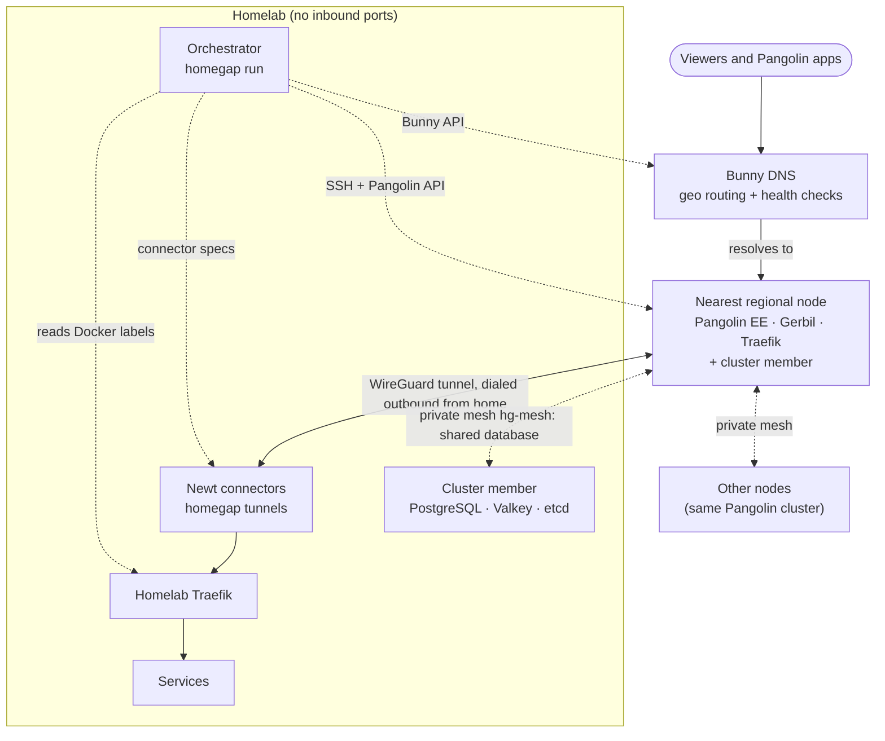

<div align="center">

# HomeGAP

**Homelab Global Access Platform**

Publish homelab services worldwide through your own regional edge nodes — no inbound ports, no third-party tunnel.

[](https://github.com/DrewCarlson/HomeGAP/actions/workflows/build.yml)
[](LICENSE)
[](https://github.com/DrewCarlson/HomeGAP/pkgs/container/homegap)

</div>

---

HomeGAP is a self-hosted alternative to Cloudflare Tunnels and WARP. Your homelab stays the single
origin and is never exposed; regional VPS nodes terminate connections close to each audience and
tunnel back home over outbound-only WireGuard. A single controller container drives everything
from Docker labels:

- **Regional nodes** are any Ubuntu VPS, from any provider and in any location, running
  [Pangolin EE](https://github.com/fosrl/pangolin) with Gerbil and Traefik.
- **[Bunny DNS](https://bunny.net/dns/)** steers each viewer to the nearest node and fails over
  using health checks.
- **The orchestrator** reads Docker labels on the homelab and turns them into Pangolin resources
  on every node, the Newt tunnels that feed them, and the Bunny DNS records that steer viewers.
  It also provisions and maintains the nodes themselves over SSH.

> [!NOTE]
> HomeGAP is early-stage software. Validate it on a domain that nothing depends on yet — a spare
> domain, or a subdomain delegated to Bunny — before moving production traffic onto it (see
> [Getting started](#getting-started)).

## Table of contents

- [Features](#features)
- [Architecture](#architecture)
- [Requirements](#requirements)
- [Getting started](#getting-started)
- [Service labels](#service-labels)
- [Configuration](#configuration)
- [Operations](#operations)
- [Performance](#performance)
- [Dashboard & API](#dashboard--api)
- [Security model](#security-model)
- [Failure modes](#failure-modes)
- [Development](#development)
- [Contributing](#contributing)
- [Acknowledgements](#acknowledgements)
- [AI assistance](#ai-assistance)
- [License](#license)

## Features

- **Origin stays hidden** — no inbound ports at home; every tunnel is outbound.
- **End-to-end TLS by default** — nodes route by SNI and never see plaintext; flip one label to
  terminate on the node instead.
- **HTTP(S), raw TCP and UDP**, plus private services reachable only through the Pangolin client.
- **Geo routing with health-checked failover** — viewers reach the nearest healthy node.
- **A VPN that outlives the homelab** — with the [cluster](#clustered-pangolin), every node is
  one Pangolin with shared users and devices. Pangolin apps connect through the nearest node,
  and signing in keeps working while the homelab is down.
- **One-label exposure** — Docker labels are the source of truth; the controller reconciles the rest.
- **Hands-off node lifecycle** — bare VPS to working edge node over SSH, with drift repair.
- **Built-in dashboard** for observability, pausing, re-provisioning and node management.
- **Controller is never in the traffic path** — if it stops, nodes keep serving, tunnels stay
  up and DNS keeps resolving. Everything remains manageable by hand: SSH into a node, use each
  node's Pangolin dashboard, or use the Bunny console.

## Architecture

Solid arrows are viewer traffic; dashed arrows are the orchestrator's control plane, which is
never in the traffic path.



With `cluster:` in the config, every node's Pangolin is one instance of a single Pangolin EE
cluster. They share a database that has a member on the homelab and on every node, over a
private WireGuard mesh. The homelab holds the primary while it's up, and the nodes elect one of
themselves while it isn't. Without `cluster:`, each node runs an independent Pangolin; everything
below except the cluster sections still applies.

### Reconciliation

The orchestrator is a reconciler. It continuously drives the *actual* state toward the *desired*
state. Desired state is the Docker labels plus the config file and nothing else. The orchestrator
works in six independent domains, so a failure in one never blocks the others:

| Domain | What it does |
| --- | --- |
| Discovery | Reads `homegap.*` labels from the Docker socket (mounted read-only). If discovery fails, the resource and DNS domains are skipped for that pass, so an empty view can never delete anything. |
| Nodes | Uses SSH to turn a bare Ubuntu 22.04/24.04/26.04/26.10 VPS into a Pangolin EE node: preflight, Docker, `ufw`, the compose stack, secrets, health wait, headless bootstrap (admin, org, least-privilege API key, license) and a verify step. Every step is idempotent, and a periodic drift check repairs out-of-band changes. |
| Tunnels | On each node, keeps a Pangolin site that represents the homelab. Writes one Newt connector spec per node for the `homegap tunnels` supervisor. |
| Resources | Declares Pangolin resources through per-resource blueprints keyed by deterministic `hg-*` niceIds. It deletes only stale `hg-*` resources and never touches unmanaged ones. It also writes the node's hot-reloaded Traefik routes (SNI passthrough, health, management API). |
| DNS | Keeps Bunny geo record sets for the root, the wildcard and each dedicated hostname, plus a plain record per node management host. |
| Observability | Collects node, tunnel, resource and DNS health for the dashboard. |

Reconciliation runs in three ways at once:

- **Event-driven:** on Docker events, debounced.
- **Periodic:** a full resync, every 60s by default.
- **On demand:** from the dashboard.

Every pass applies only the minimal diff.

### Traffic paths

- **Front door, passthrough (default).** The homelab Traefik claims the root domain and
  `*.domain`. On each node, a Traefik TCP router on `:443` matches the TLS SNI (root, plus any
  single label under the domain) and forwards the still-encrypted stream into the Pangolin TCP
  resource and through the tunnel to the homelab Traefik. The node never sees plaintext, and
  Authelia and anything else at home keep working unchanged.
- **Front door, terminate.** Setting `homegap.tls=terminate` swaps in Pangolin HTTP resources for
  the root and the wildcard. The node ends TLS (it already holds the same wildcard certificate)
  and re-proxies to the homelab Traefik with the host preserved. Wildcard HTTP resources are a
  Pangolin EE feature and need a license key on every node (see [EE licenses](#ee-licenses)).
  A node that refuses the wildcard is automatically left out of the wildcard DNS set, so viewers
  are never steered to a node that would answer 404.
- **Dedicated subdomain.** A labeled service with its own hostname gets its own resource, which
  takes precedence over the wildcard. HTTPS services default to passthrough straight to the
  service; plain HTTP services are terminated on the node.
- **Raw TCP/UDP.** The service gets its own public port on its nodes: a Traefik entrypoint, a
  published Gerbil port and a `ufw` rule. It also gets its own DNS record.
- **Private.** Private services become Pangolin private resources, with an alias set to the
  hostname. They are reachable only through the Pangolin client, and get no public DNS record and
  no public port. In a cluster, one private resource lists every node's site: a Pangolin app
  connects to `pangolin.<domain>`, which DNS sends to the nearest healthy node, and relays through
  that node to the homelab. The node is chosen when the app connects or changes network.

### Health and failover

Each geo record carries a Bunny HTTP monitor. Bunny probes `http://<node-ip>/` every 30s from
three regions. On the node, that request is routed through the tunnel to the front door's
`homegap.healthcheck` path, so a node only counts as healthy when it is up, its tunnel is up and
the origin answers:

- If the origin is down, the probe gets a 502.
- If the tunnel is down, the probe fails within 5s.

Bunny drops offline members from a record set, so those viewers resolve to the next-nearest node.
When every member is offline, Bunny returns all of them (fail-open). Realistic failover time is
the health interval plus the 60s TTL plus resolver caching: roughly 1–5 minutes.

In a cluster, the database fails over on its own: when the member holding the primary is gone,
the remaining members elect another in about 30 seconds, and HomeGAP moves the primary back to
the homelab once it has been caught up for `cluster.primary.switch_back_after`. See
[Cluster database](#cluster-database) and [Failure modes](#failure-modes).

## Requirements

| Component | Requirement |
| --- | --- |
| Homelab | Docker with Compose; a Traefik instance fronting your services |
| Regional nodes | Ubuntu 22.04, 24.04, 26.04 or 26.10 VPS (x86_64 or aarch64), public IPv4 (IPv6 optional), and SSH access: either root or a sudo user with a password or key (the [add-node wizard](#adding-a-node) sets up the rest), or a user with passwordless sudo and a key you configure yourself |
| DNS | A [Bunny DNS](https://bunny.net/dns/) zone and API key |
| Pangolin EE license | Optional; required for wildcard resources in `terminate` mode. One key for a cluster, or one per node without it (see [EE licenses](#ee-licenses)) |
| Nodes for the cluster | Two or more, so the cluster can elect a primary (and keep sign-ins working) while the homelab is down |

## Getting started

The container image is published at `ghcr.io/drewcarlson/homegap` for `linux/amd64` and
`linux/arm64`. The same image runs both the orchestrator (`homegap run`) and the tunnel
supervisor (`homegap tunnels`).

### Manual steps (once)

1. Choose a test domain that no live services depend on — a spare domain, or a subdomain of your
   real domain (e.g. `gap.example.net`) delegated to Bunny with NS records — host it in Bunny DNS,
   and create an API key.
2. Create a bare VPS per region (Ubuntu 22.04, 24.04, 26.04 or 26.10). Once the orchestrator
   runs, add it with the dashboard's [add-node wizard](#adding-a-node), starting from the root
   password your provider gives you. Or set it up yourself: a user with passwordless sudo and a
   dedicated SSH key per node, then add it to `nodes[]`.
3. Label your Traefik container (root + wildcard + `tls`, see [Service labels](#service-labels))
   and write `config/config.yml` starting from
   [`config/config.example.yml`](config/config.example.yml). Add `cluster: {}` for
   [clustered Pangolin](#clustered-pangolin) (recommended with two or more nodes).
4. Run the orchestrator and the tunnel supervisor on the homelab
   ([`deploy/homelab-compose.yml`](deploy/homelab-compose.yml)) with the Docker socket mounted
   read-only, plus the config, the SSH keys and the secrets.

> [!TIP]
> Try `HOMEGAP_DRY_RUN=true` first: it runs full discovery and logs the desired state, with no
> SSH, API or DNS writes. `homegap plan --labels labels.json` prints what a set of labels
> produces without touching Docker.

### Automated by the orchestrator

5. With the cluster: set up the private mesh and the shared database (homelab member first, then
   each node).
6. Provision each node (Docker, `ufw`, Pangolin EE + Gerbil + Traefik, secrets, certificate,
   admin, org, API key, license).
7. Create one homelab site per node and one Newt connector per node.
8. Create the passthrough or terminate resources, the dedicated resources, and the Bunny geo
   records and monitors.
9. Verify on the test domain: nodes green, each name resolving per region, failover working, and
   the passthrough/terminate toggle working. Then point `domain` at your production domain and
   move it to Bunny.
10. With the cluster: add people on the dashboard's **Access** page, and put
    `https://pangolin.<domain>` into their Pangolin apps (see [Users and devices](#users-and-devices)).

## Service labels

Exposing a service is a one-label change. Everything the homelab Traefik fronts needs no labels:
the Traefik container's claim on the root and the wildcard covers it.

| Label | Default | Description |
| --- | --- | --- |
| `homegap.expose` | — (required) | Hostname to expose, e.g. `app.example.net`, or the root `example.net`. Must be inside `domain`. |
| `homegap.wildcard` | `false` | On the root entry, also claim `*.<domain>`. |
| `homegap.port` | 443 for https, 80 for http | Target container port. Required for tcp/udp. |
| `homegap.protocol` | `http` | `http` / `https` / `tcp` / `udp` |
| `homegap.tls` | `passthrough` | `passthrough` (the node sees only SNI) or `terminate` (the node ends TLS; Pangolin auth possible). Plain `http` is always terminated. |
| `homegap.regions` | `all` | Comma-separated list of node ids, e.g. `na1,as1`. |
| `homegap.access` | `public` | `public`, or `private` (Pangolin client only). |
| `homegap.auth` | `none` | `none` / `sso` / `pin`. Requires `tls=terminate`. |
| `homegap.healthcheck` | `/` (front door probe) | HTTP path or `tcp`. Used for Pangolin target health and by the node's Bunny health probe. |

Extensions:

| Label | Description |
| --- | --- |
| `homegap.host` | Host the tunnel dials. Defaults to the container name, which must resolve on a network shared with the `tunnels` container. |
| `homegap.public_port` | Public port on nodes for tcp/udp services. Defaults to `homegap.port`. Ports used by the node itself (22, 80, 443, 51820, …) are rejected. |
| `homegap.roles` | Pangolin roles allowed for `auth=sso` and private resources. |
| `homegap.pin_env` | Environment variable on the orchestrator holding the 6-digit PIN for `auth=pin`. |
| `homegap.pause` | `true` holds this service's Pangolin resources and DNS records as they are. |

### Examples

```yaml
# The homelab Traefik claims root + wildcard with end-to-end TLS.
traefik:
  labels:
    homegap.expose: "example.net"
    homegap.wildcard: "true"
    homegap.protocol: "https"
    homegap.tls: "passthrough"      # flip to "terminate" to A/B test

# A raw-TCP service on its own subdomain, private, on two nodes.
ssh-jump:
  labels:
    homegap.expose: "ssh.example.net"
    homegap.port: "22"
    homegap.protocol: "tcp"
    homegap.access: "private"
    homegap.regions: "na1,as1"

# A public game server on UDP 27015, served from one region.
game:
  labels:
    homegap.expose: "game.example.net"
    homegap.protocol: "udp"
    homegap.port: "27015"
    homegap.regions: "eu1"
```

Errors are reported per container in the dashboard and the log, and never block other services.
Examples of errors: an unknown protocol, auth without terminate, a reserved public port, or a
hostname claimed twice.

## Configuration

One YAML file holds the configuration. A complete example is
[`config/config.example.yml`](config/config.example.yml). Secrets are referenced, never inlined:

- `*_env` names an environment variable.
- `*_file` names a mounted file.
- `/run/secrets/<ENV_NAME>` is also checked, so Docker secrets work.

Key sections:

| Section | Purpose |
| --- | --- |
| `domain`, `bunny.zone` | The served domain and its Bunny zone (equal to, or a parent of, the domain). |
| `bunny.routing` | `geolocation` uses each node's `location` (latitude/longitude). If only a `region` code is given (`NA`, `SA`, `EU`, `AF`, `ME`, `AS`, `OC`), a rough centroid is used. `latency` uses `latency_zone`. `none` turns off smart routing. |
| `bunny.monitor` | `http` (recommended), `ping` or `none`. |
| `pangolin` | Image versions, ACME email, org id, optional default `license_key_env`, optional CrowdSec, and `base_blueprint` — a Pangolin blueprint applied to every node before the managed resources. |
| `certificates` | How the wildcard + root certificate reaches the nodes: `none` (nodes use their own ACME HTTP-01), `files` (PEM chain and key), or `acme_json` (read the homelab Traefik's ACME store, mounted read-only; the certificate must be issued with DNS-01, for example Traefik's `bunny` provider). |
| `nodes[]` | Per node: `id`, `host`, SSH user, port and key file, `location`, and optionally `license_key_env` (each node needs its own EE key), `public_ipv4` / `public_ipv6`, `management_host` (default `pangolin-<id>.<domain>`), `dashboard_public` (default `false`), `firewall` (default `true`), `ssh_allow_from` (sources allowed to reach SSH through the firewall, IPv4/IPv6 addresses or CIDRs; empty, the default, allows SSH from anywhere — see [Adding a node](#adding-a-node) before restricting it), `install_docker` (default `true`). |
| `tunnels` | Shared state directory, `mtu` (WireGuard MTU for Newt and every Gerbil) and `native` (kernel WireGuard for Newt). See [Performance](#performance). |
| `cluster` | Optional. `mesh.subnet` (default `10.77.0.0/24`) and `mesh.port` (default `51821/udp`) for the private WireGuard mesh between the homelab and every node. `image` (default `ghcr.io/drewcarlson/homegap-cluster:latest`) runs each member's database services. `primary.preferred` (default `homelab`) and `primary.switch_back_after` (default `10m`) decide where the database primary lives. `client_hostname` (default `pangolin`) names the geo-routed address clients and the login pages use. See [Cluster mesh](#cluster-mesh), [Cluster database](#cluster-database) and [Clustered Pangolin](#clustered-pangolin). |
| `pangolin.tcp_tuning` | BBR, fq and larger TCP buffers on every node (default `true`). |
| `speedtest` | `enabled`, `hostname` (default `speedtest`), `bind` (default `0.0.0.0:8089`), `link_ttl`, `phase_seconds`, `streams` (homelab ↔ node, default 4). |
| `dashboard` | Bind address, optional bearer token, and whether config edits from the UI are allowed. |
| `reconcile` | `resync_interval` (default `60s`; Docker events trigger passes immediately in between), `debounce`, `node_check_interval` (SSH drift check, default `5m`), `dns_check_interval` (how often the Bunny zone is re-read when the desired records are unchanged, default `5m`; changes sync at once), `dry_run`. |

The orchestrator re-reads the file on every pass. An invalid edit is logged, and the last good
configuration stays in effect.

### EE licenses

Pangolin EE license keys are **bound to a single Pangolin instance** when first activated: a
second instance trying the same key is rejected ("already been activated with a different
instance name").

- **With the cluster, one key covers every node**, because they share one database. Set
  `pangolin.license_key_env`. HomeGAP activates it through the first node that can and tells the
  others to re-read it. Per-node keys are ignored. The cluster database panel shows the license
  state.
- **Without the cluster, each node needs its own key.** Give each node one with
  `nodes[].license_key_env`; `pangolin.license_key_env` is only a default for single-node setups.
  A rejected key is reported once per node (dashboard check `ee-license`) and is not retried
  until the key changes.

> [!WARNING]
> Activations are recorded by the license server, so avoid activating production keys on
> throwaway or test instances.

### Node updates and rollback

Provisioning runs in the background, so a slow node (a first install, a Docker download) never
delays health checks, tunnels or DNS for the others. The dashboard shows `provisioning…` or
`updating…` on the node while it runs.

When a change alters the stack of nodes that are already healthy (a new image version, MTU,
tuning, raw ports and so on), the update **rolls out one node at a time**:

1. The running stack is saved on the node (`<install_dir>/.homegap-rollback`): every managed file
   and, when the Pangolin image changes, Pangolin's database, since a newer version migrates it.
2. The node is updated, then must pass Pangolin's health check, the API bootstrap, the verify
   checks (Gerbil UDP ports, Integration API) and, if its tunnel was up, the tunnel reconnecting.
3. If any step fails, the saved stack is restored and restarted, and the node keeps serving on it.

A failed update **holds the rollout**: no other node is updated, and the dashboard shows a banner
with the error. To recover:

- **Retry**: apply the update to that node again (after fixing the cause on the node).
- **Skip**: leave that node on its current stack and let the rollout continue with the others.
- **Change the config**: a new desired stack is tried on the failed node first, then rolls out.
  Reverting the change clears the failure.

New nodes and drift repairs do not wait for rollouts. A first provisioning that fails is retried
after five minutes, or at once with *Re-provision*. Host-level steps (Docker, firewall, TCP
tuning) are idempotent and not rolled back.

### Adding a node

The dashboard's **Nodes → Add node** wizard takes a fresh VPS from the credentials your provider
gives you to a provisioned node. Setup runs on the orchestrator as a background job, so you can
leave the page while it works.

1. **Server:** node id, public IP or host name, SSH port, and a region code or coordinates.
2. **Initial login:** root (or another user that can sudo) with a password or a private key file.
   *Test connection* checks the login and reports the OS, how root access works, whether Docker is
   installed, the host key fingerprint (compare it with your provider's console) and the address
   the node sees the orchestrator connect from. A changed host key is reported, and can be
   forgotten after you confirm the server was rebuilt.
3. **Access:** the user HomeGAP manages the node as (by default a new `homegap` user with
   passwordless sudo, optionally in the `docker` group) and its SSH key: generated (ed25519, kept in
   `<data dir>/ssh/`), pasted, or a key file already on the orchestrator. Optionally disable root
   login and password login over SSH.
4. **Firewall:** let HomeGAP manage `ufw`, and choose whether SSH is open to anywhere or only to
   listed sources (pre-filled with the address seen in the connection test).
5. **Review & run.**

Setup logs in once with the initial credentials and runs every step through that one connection.
Servers with a login blocker (fail2ban, sshguard, CrowdSec) ban addresses that open many SSH logins
in a short time, so the only other logins are the checks that must prove a new login works. If a
blocker is installed, the orchestrator's address (as the server sees it) is exempted from it first,
and any current ban on it is lifted.

Each change is proven before it is kept:

- The new user's key login and passwordless sudo are checked over a fresh connection before SSH is
  hardened.
- SSH settings go into `/etc/ssh/sshd_config.d/01-homegap.conf` (ahead of cloud-init's drop-in),
  are syntax-checked, and their effective values are checked (`sshd -T -C`) for root, the login
  user and the management user connecting from the orchestrator's address, so a `Match` block
  that overrides them is caught. They are applied while the setup connection stays open; a fresh
  key login must then succeed, or the previous settings are restored.
- Before SSH settings or the firewall change, a timer on the node is armed to undo the change
  after two minutes; it is disarmed only once a fresh login works. If the orchestrator loses the
  node mid-change, the node reverts by itself.

The password is used only for the setup job and is never written to disk or the config: it reaches
`ssh` through `SSH_ASKPASS`, and `sudo` on its standard input. A failed job shows which step
failed and why; fix the cause and retry. Re-running is safe: completed steps are idempotent, and if
an earlier run already disabled the password login, setup continues with the node key.

> [!WARNING]
> Restricting SSH with `ssh_allow_from` locks the orchestrator out if its public IP changes to an
> address not listed (a residential IP, a new ISP, a moved homelab). Provisioning and health checks
> for that node then fail until the rule is fixed. Prefer a stable range, or leave SSH open to
> anywhere with password login disabled. To recover, log in through your provider's web console
> and run `ufw allow <ssh port>/tcp`, then update `ssh_allow_from`; the next pass replaces the rules.

### Cluster mesh

Setting `cluster:` in the config builds a private WireGuard mesh, `hg-mesh`, between the
homelab and every node. It is the first part of clustered Pangolin (see
[the build plan](docs/clustered-pangolin-plan.md)); cluster traffic will only ever cross it.

- **Addresses are fixed.** The homelab is host 1 of `mesh.subnet`, and a node is host
  `10 + slot`, its permanent tunnel slot.
- **Node keys stay on the node.** Each node creates its own key on first setup. HomeGAP only
  learns the public key.
- **The homelab works behind NAT.** It dials every node and keeps the paths alive, so its address
  is never published. Nodes reach each other directly on their public addresses.
- **The node firewall opens `mesh.port`/udp** to anywhere: WireGuard authenticates every packet,
  and the homelab's address can change.
- **Nodes reach only the homelab's cluster services.** Inbound traffic on the homelab's end of
  the mesh is dropped except replies, ping and the [cluster database](#cluster-database) ports,
  so the dashboard stays private.
- **Each node's interface is managed by `wg-quick`** (enabled at boot). Peer changes apply in
  place without dropping existing sessions.

On the homelab, the mesh interface lives in the `homegap-mesh` container's network namespace
(see [`deploy/homelab-compose.yml`](deploy/homelab-compose.yml)). The orchestrator joins it with
`NET_ADMIN`, so the interface outlives orchestrator restarts. The host kernel needs WireGuard
(built into Linux 5.6 and later). The dashboard's **Nodes** page shows each member's last
handshake with every other.

### Cluster database

With `cluster:` set, the homelab and every node also run one member of a shared database, the
one clustered Pangolin will use. Each member runs five containers from the `homegap-cluster`
image: etcd (the vote), PostgreSQL under Patroni, Valkey, Valkey Sentinel and HAProxy.

- **The homelab is the primary.** It starts the cluster, and nodes join one at a time: first
  the vote, then as streaming replicas.
- **Nodes take over when the homelab is gone.** If the homelab drops off the mesh, the nodes that
  can still reach a majority of the vote promote one of themselves, in about 30 seconds. A member
  that loses the majority (the homelab, if it's the one cut off) demotes itself, so two
  primaries never accept writes.
- **The homelab takes it back.** When it returns, it rejoins as a replica (rewinding any writes
  it took after losing the vote). After it has stayed caught up for `primary.switch_back_after`,
  HomeGAP switches the PostgreSQL primary back to it, then Valkey.
- **Services find the primary through HAProxy.** On each node, containers on the
  `homegap-cluster` Docker network connect to `cluster-proxy:5433` (PostgreSQL) and
  `cluster-proxy:6380` (Valkey). HAProxy follows the current primary and cuts connections to a
  member that's demoted.
- **The vote needs a majority.** With the homelab and one node, losing either stops writes.
  Two or more nodes are needed for the cluster to keep working without the homelab.
- **Passwords are generated once** and kept in `cluster/secrets.json` in the data directory.
- **The homelab member keeps backups.** It writes a nightly `pg_dump` to `./backups` next to the
  homelab compose file and keeps the newest seven.

Each node's member is its own compose project in `/opt/homegap/cluster`, separate from the
Pangolin stack, so stack updates never restart the database. Removing a node removes its member
from the vote and deletes its data.

The **Nodes** page has a **Cluster database** panel:

- **Each member:** its vote (etcd), its PostgreSQL role and replication lag, and its Valkey role.
- **Whether the vote has a majority**, and when a pending switch-back is due.
- **Alerts:**
  - no majority, or no primary;
  - a member cut off from the others (by its mesh handshakes or its vote);
  - a replica more than 16 MiB behind;
  - fewer than two nodes, so the cluster can't elect a primary without the homelab;
  - the license state.
- **The primary's history:** each change, and whether it was a failover, a switch-back or
  manual.
- **Make primary** on a caught-up replica: a planned switchover (writes pause for a second or
  two, nothing is lost). If the new primary isn't where it belongs, the switch-back returns it
  after the hold.

### Clustered Pangolin

With `cluster:` set, every node's Pangolin is one instance of a single Pangolin EE cluster on the
[cluster database](#cluster-database), instead of an independent Pangolin with its own SQLite
database. There is one org, one set of users and one license.

- **Each node runs the PostgreSQL build** of the configured image (`ee-<version>` becomes
  `ee-postgresql-<version>`).
- **Writes go to the current primary, reads stay local.** Pangolin writes through
  `cluster-proxy` and reads from the node's own database member. Signing in and using the
  session straight away works through a node ~300 ms from the primary (tested in e2e with added
  mesh latency).
- **Each node is its own region.** The homelab gets one site per node (`<site_name>-<node id>`),
  created through that node so its connector always uses that node's exit node.
- **Each service is one resource with a target on every node's site.** HomeGAP applies them
  once per pass, through the first ready node. A node only routes through its own target, so
  every node keeps its own tunnel to the homelab and none relays through another. Private
  resources list every serving node's site, and a client uses whichever is nearest when it
  connects. Each node still has its own health resource (`hg-health-<node id>`) and speed test
  host, and passthrough ports are the same on every node.
- **DNS only steers a hostname to a node whose own target exists**, as before.
- **Traefik reads Pangolin's routes from a file** (`traefik.file_mode`), which each node writes
  for its own sites. HomeGAP's passthrough routes sit next to it in the same directory.
- **One address for clients: `<client_hostname>.<domain>`** (default `pangolin.<domain>`). Every
  node serves Pangolin's login pages and API on it, and a geo-routed record with a health
  monitor points it at the nearest healthy node, so signing in and enrolling devices work while
  the homelab is down. Point the Pangolin apps at this address. Passthrough never captures it.
- **Gerbil's API is reachable over the mesh only** (on the node's mesh address), so the
  cluster's other Pangolins can reach it. Docker starts after the mesh interface.
- **One admin, one API key, one license.** The first node sets up the cluster's admin, org and
  API key. The admin and server secret are kept in the controller's state and on every node, so
  they can be recovered from any node. `pangolin.license_key_env` is activated once, through the
  first node that can, and the other nodes are told to re-read it. A per-node `license_key_env`
  is ignored.
- **Nodes start one at a time until the cluster's Pangolin exists**, so the empty database is
  migrated only once. A node's stack waits until its database member is streaming.
- **Upgrades are rolled out one node at a time, as before.** The first node to start a new
  Pangolin version (the one that migrates the database) saves a dump of it first. If that update
  fails, rolling it back also restores the dump.

#### Moving an existing deployment onto the cluster

Nothing on a standalone node's Pangolin needs copying: its sites, resources and API key are
all generated from labels and config. So adding `cluster:` to the config of a running
deployment rebuilds each node instead:

1. **The homelab member and the mesh come first.** Each node joins the mesh and the database
   cluster next to its running stack. Live traffic isn't touched.
2. **Then one node at a time**, through the usual rollout (a failed one rolls back and holds the
   rest):
   - **It leaves DNS.** Its records are dropped from every name another node also serves, and
     the switch waits one TTL so resolvers stop sending viewers to it. A name only that node
     serves stays put.
   - **It switches to the cluster's Pangolin.** The first node sets up the cluster's admin, org,
     API key and license. Each node gets a new homelab site, and its connector is re-keyed.
   - **It returns to DNS** once its site is online and every resource it serves exists.
3. **Standalone and cluster nodes coexist meanwhile.** Each keeps its own tunnel to the homelab,
   so public traffic is unaffected.

The old standalone database stays in `config/db` on each node (a failed switch rolls back to it).
Removing `cluster:` again moves the nodes back to their standalone Pangolins the same way, one at
a time and out of DNS while they switch. Their mesh and database members are left in place.
Once every node has moved, the per-node `license_key_env` keys are no longer used: the cluster
needs only `pangolin.license_key_env`, and the per-node keys can be released.

#### Users and devices

With the cluster on, the dashboard's **Access** page manages who can sign in to the Pangolin
apps, without logging in to Pangolin as the admin:

- **The address for the apps**, `https://<client_hostname>.<domain>`, to copy into the
  Pangolin app (self-hosted server).
- **Add a user** by email, with one or more roles (new users default to the least-privileged
  one). Either set a password there (the user can sign in at once; share it with them
  privately) or create an invite link (valid 7 days) for the person to pick their own.
- **Users:** change roles or remove a user. The server admin HomeGAP created is listed but
  can't be removed here. Open invitations can be withdrawn.
- **Devices:** each person's apps and every machine client, whether it's online, and the node
  it relays through. Block, archive or delete a device.

Changes go through whichever node's Pangolin is reachable (they all share one database) and are
written to the reconcile log. HomeGAP grants its API key the permissions this needs the first
time it runs (one admin login).

### Node management host

Newt and the Pangolin client must reach each node's Pangolin API. HomeGAP routes
`https://<management_host>/api/v1` on each node. That hostname is excluded from the wildcard
passthrough and has its own plain DNS record. The node's web UI is not routed publicly by default.
To reach it, use SSH port forwarding:

```bash
ssh -L 3002:127.0.0.1:3002 deploy@<node>
```

Then open `http://localhost:3002`. Set `dashboard_public: true` if you use `auth: sso|pin`, which
needs the node's login pages to be public.

## Operations

- **Expose a service:** add labels to its container. The Docker event triggers a reconcile.
- **Add a region:** use the dashboard's [add-node wizard](#adding-a-node), or add a node to the
  config. It is provisioned and DNS is extended on the next pass.
- **Remove a region:** remove it from the config. Its DNS records drain on the next pass, and the
  stack keeps running until you confirm the decommission in the dashboard.
- **Hold a manual change:** pause globally, per node or per service (dashboard or
  `homegap.pause`). Paused targets are observed but never modified.
- **Re-provision a node:** click *Re-provision*. Destroying and recreating a VPS is safe: nodes
  are cattle.

## Performance

Every request crosses two TCP legs (viewer → node, node → homelab) and one WireGuard tunnel.
Three settings matter most:

| Setting | Effect |
| --- | --- |
| `pangolin.tcp_tuning: true` (default) | Writes `/etc/sysctl.d/99-homegap.conf` on each node: BBR congestion control, `fq` qdisc, socket buffers up to 64 MiB, MTU probing, higher reordering tolerance. The same TCP settings are applied inside the node's Gerbil/Traefik namespace (Docker containers do not inherit the host's); the Nodes tab shows them as `edge tcp`. BBR keeps long, lossy paths fast. The node fact `tcp_cc` (Nodes tab) shows what the kernel actually uses; some VPS kernels refuse. |
| `tunnels.mtu: 1420` | Sets the WireGuard MTU on both ends (Newt `--mtu`, Gerbil `--mtu`). The upstream default of 1280 costs throughput. Lower it if the path has PPPoE or another tunnel: check with `ping -M do -s <mtu - 28> <node>` from the homelab. |
| `tunnels.native: true` | Runs each Newt main tunnel on a kernel WireGuard interface instead of Newt's userspace network stack, usually the largest gain. The `tunnels` container then needs `cap_add: [NET_ADMIN]`, `devices: [/dev/net/tun]` and a host kernel with WireGuard. |

Each node gets a permanent tunnel slot, stored in the orchestrator's state, which picks its
tunnel subnet (`100.89.<128 + 4·slot>.0/22`), its kernel interface (`hgnewt<slot>`) and its local
ports, so connectors for several nodes can coexist in the `tunnels` container. New nodes take the
lowest free slot; removing or reordering nodes never moves another node. Pangolin fixes the subnet
when a node first registers its exit node, and the orchestrator checks each node's slot against
its live site subnet. Two nodes sharing a subnet (for example, both created before slots existed)
are reported as an error: re-create one node's Pangolin database before enabling `native`.

For the homelab side in native mode, tune the `tunnels` container itself. TCP settings are per
network namespace, so the host's `/etc/sysctl.d` does not reach containers, and the defaults
(cubic, a 4 MiB send buffer) cap every download from the homelab to a distant node. Set them on
the service (see `deploy/homelab-compose.yml`):

```yaml
sysctls:
  net.ipv4.tcp_congestion_control: bbr   # needs `modprobe tcp_bbr` on the host
  net.ipv4.tcp_rmem: "4096 131072 67108864"
  net.ipv4.tcp_wmem: "4096 65536 67108864"
  net.ipv4.tcp_slow_start_after_idle: "0"
  net.ipv4.tcp_mtu_probing: "1"
  net.ipv4.tcp_reordering: "10"          # tolerate reordering on long routes
  net.ipv4.tcp_max_reordering: "1000"
```

Check with `docker compose exec tunnels sysctl net.ipv4.tcp_congestion_control net.ipv4.tcp_wmem`.
On a path with about 170 ms round trip this took one setup from about 115 to about 250 Mbps.
Also enable `fq` on the host (`net.core.default_qdisc = fq`), which BBR paces with.

In userspace mode Newt uses its own TCP stack, so these settings do not apply; raising
`net.core.rmem_max` / `net.core.wmem_max` on the host (for example to `7500000`) still helps its
UDP socket.

### Speed tests

With `speedtest.enabled: true` the orchestrator serves a speed test origin on `speedtest.bind`.
Route `speedtest.<domain>` and `speedtest-<node>.<domain>` to it from the homelab reverse proxy
(the front door already forwards them from the nodes). For Traefik labels on the orchestrator:

```yaml
labels:
  traefik.enable: "true"
  traefik.http.routers.homegap-speedtest.rule: "Host(`speedtest.example.net`) || HostRegexp(`^speedtest-[a-z0-9-]+\\.example\\.net$`)"
  traefik.http.routers.homegap-speedtest.entrypoints: websecure
  traefik.http.routers.homegap-speedtest.tls: "true"
  traefik.http.services.homegap-speedtest.loadbalancer.server.port: "8089"
```

The dashboard's *Speed test* tab offers two measurements: ping, jitter, download and upload.

- **Homelab ↔ node:** runs `curl` on the node over SSH against its own port 443 with the node's
  speed test hostname, so the traffic takes the production path through the tunnel. Runs
  `speedtest.streams` parallel streams (default 4, selectable per run); rates are the sum. One
  stream shows what a single connection gets over the distance; several show the tunnel's capacity.
- **Device → node → homelab:** creates a short-lived link (`speedtest.link_ttl`) to open on any
  device. `http://speedtest.<domain>/` is answered by whichever node DNS picks for the device,
  which redirects to its own `speedtest-<node>` hostname, so results are attributed to a node.
  The token travels in the URL fragment, which is never sent to a server or logged.

Results are kept in `<data_dir>/speedtests.json`. Changing `speedtest.enabled` or `bind` needs an
orchestrator restart.

## Dashboard & API

The dashboard is served by the orchestrator on `dashboard.bind`.

> [!IMPORTANT]
> Expose the dashboard **only** as a private Pangolin resource, never publicly.

It shows:

- **Nodes:** reachability; Docker, Pangolin, Gerbil and Traefik health; certificate expiry;
  tunnel state; last provision; drift.
- **Services:** per-region health.
- **DNS:** records, monitor state and whether they match the desired state.
- **Tunnels:** process state, restarts and throughput.
- **Speed test:** homelab ↔ node and device → node → homelab measurements, with history.
- **Access** (cluster only): the cluster's users, invitations and devices; see
  [Users and devices](#users-and-devices).
- **Reconcile log:** grouped by domain.
- **Desired vs. actual:** the diff, plus every referenced secret with whether it is present.
  Secret values are never shown.

| Method & path | Purpose |
| --- | --- |
| `GET /api/status` | Full status snapshot |
| `GET /api/events?after=SEQ` | Server-sent events: `status` (the snapshot, sent only when it changes) and `log` (new entries after `SEQ`). The dashboard uses this instead of polling. |
| `GET /api/log?domain=` | Recent reconcile log |
| `GET /api/diff` | Desired-vs-actual items and the effective desired state |
| `GET /api/secrets` | Referenced secrets (names, sources, presence only) |
| `GET /api/config` | Config file and nodes |
| `POST /api/resync` | Queue a pass |
| `POST /api/nodes/{id}/provision` | Force a full re-provision |
| `POST /api/nodes` / `DELETE /api/nodes/{id}` | Add / remove a node (rewrites the config file, with a backup) |
| `POST /api/nodes/{id}/decommission?confirm={id}` | Stop the stack on a removed node and forget it |
| `POST /api/cluster/switchover` | Make a caught-up replica the database primary now: `{to}` (cluster only) |
| `GET /api/access` | The cluster's users, roles, open invitations and devices (cluster only) |
| `POST /api/access/users` | Add a user: `{email, roleIds, password?}`; without a password, the response has the invite link |
| `DELETE /api/access/users/{id}` / `PUT /api/access/users/{id}/roles` | Remove a user / set their roles (`{roleIds}`) |
| `DELETE /api/access/invitations/{id}` | Withdraw an open invitation |
| `POST /api/access/devices/{id}/{action}` | `block`, `unblock`, `archive`, `unarchive` or `delete` a device |
| `GET /api/speedtest` | Speed test settings and recent results |
| `POST /api/speedtest/nodes/{id}` | Run a homelab ↔ node speed test (blocks until done) |
| `POST /api/speedtest/link` | Create a device test link |
| `POST /api/setup/test` | Test an initial SSH login (`host`, `port`, `user`, `password` or `keyFile`, `resetHostKey`) |
| `POST /api/setup/keys` | Generate, import or describe a node's SSH key |
| `POST /api/setup/jobs` / `GET /api/setup/jobs/{id}` | Start a node setup job (the add-node wizard) / read its progress |
| `POST /api/pause` | `{"scope":"global|node|service","id":"…","paused":true}` |

## Security model

- **The orchestrator is the trust center.** It holds every SSH key and API key. Run it on a
  minimal host, mount secrets rather than baking them into the image, and keep the dashboard
  private (optionally also set `dashboard.auth_token_env`).
- **Node secrets** (Pangolin server secret, admin credentials, setup token, CrowdSec bouncer key)
  are generated from the kernel CSPRNG. They are pushed over SSH into
  `<install_dir>/secrets/node.json` (mode 0600), which is authoritative. The local state file
  (`/data/state.json`, mode 0600) is only a cache: if it is lost, credentials are re-read from
  the node.
- The orchestrator's Pangolin API key on each node is a root key restricted to the actions it
  needs. Older keys it minted are retired automatically.
- Node Pangolin ports (3000/3002/3003) are bound to loopback. The orchestrator reaches them only
  through SSH port forwarding.
- `ufw` allows only SSH (from anywhere, or from `ssh_allow_from`), 80/443, 51820/udp and
  21820/udp, plus raw ports that a label asks for. New rules are added before rules HomeGAP added
  earlier and no longer wants are removed; rules it did not add are left alone.
- Setup passwords given to the add-node wizard are kept in memory for the job only and never
  stored. Generated node keys are written to the data directory with mode 0600.
- The Docker socket is mounted read-only, and labels are only read. Tunnels run in a separate
  container, so the controller never carries traffic.
- `passthrough` keeps nodes blind to plaintext. Enable `pangolin.crowdsec` for edge abuse
  mitigation on terminated traffic. It cannot inspect passthrough streams.
- The homelab IP is never published. Every tunnel is outbound from home.

To report a security issue, please open a private
[security advisory](https://github.com/DrewCarlson/HomeGAP/security/advisories/new) rather than
a public issue.

## Failure modes

| Failure | Effect | Recovery |
| --- | --- | --- |
| Regional node down | Bunny drops it; its viewers resolve to the next-nearest node | The orchestrator repairs or re-provisions it; DNS recovers automatically |
| Node update fails | That node is rolled back to its previous stack; the rollout to other nodes stops | Retry or skip it from the dashboard, or change the config (see [Node updates and rollback](#node-updates-and-rollback)) |
| Orchestrator down | None on live traffic; only new label or config changes wait | Restart it; it reconciles to the desired state |
| Homelab origin down | Public services are down (single origin, by design). With the cluster, Pangolin apps stay connected and new sign-ins work after ~30 s, once the nodes elect a database primary; only homelab services are unreachable | Restore the origin; tunnels reconnect, and the primary moves back after the hold |
| Node holding the database primary down (cluster) | Sign-ins and changes pause ~30 s while the others elect a new primary; public traffic fails over through DNS as for any node | Automatic; the primary returns to the homelab after the hold |
| Homelab cut off from the nodes, but up (cluster) | The homelab loses the vote and stops taking writes; the nodes elect a primary and keep serving | Heal the link: the homelab rejoins as a replica (rewinding any writes it couldn't keep) and the primary moves back after the hold |
| Mesh link between two nodes broken (cluster) | Nothing visible while a majority of members still reach each other; the dashboard flags the isolated member | Fix the network; WireGuard reconnects on its own |
| Fewer than half the cluster members reachable | No primary can be elected: logins and changes fail; connected apps and public traffic keep working | Bring members back; the dashboard shows "no majority" |
| Newt tunnel drops | That node's health probe fails, so it drops out of DNS | The supervisor restarts Newt with backoff; failover covers the gap |
| Certificate issuance fails on a node | That node cannot serve TLS for affected names | Push the wildcard via `certificates`, or fix ACME; the dashboard shows expiry |
| A login blocker on a node (fail2ban, sshguard, CrowdSec) bans the orchestrator | SSH from the orchestrator times out or is cut before login; setup or provisioning for that node fails | Lift the ban from the provider's console or another network, then retry; the add-node wizard exempts the orchestrator's address from these blockers |
| Orchestrator IP changes while `ssh_allow_from` is set | Provisioning and SSH checks fail for those nodes; live traffic is unaffected | Allow SSH again from the provider's console (`ufw allow <port>/tcp`), then update `ssh_allow_from` |
| Bunny outage | DNS resolution affected | Accepted single dependency |
| State cache lost | None | Secrets are re-read from the nodes, API keys re-minted, Newt credentials recovered from the connector spec |

## Development

### Building

Requirements: JDK 21. Gradle, Kotlin/Native and Node for the dashboard are downloaded
automatically.

```bash
./gradlew macosArm64Test                       # unit tests (host target)
./gradlew :presentation:jsNodeTest            # dashboard presenter tests (Node)
./gradlew linkReleaseExecutableLinuxX64 linkReleaseExecutableLinuxArm64
docker buildx build --platform linux/amd64,linux/arm64 -t homegap .
./gradlew -Phomegap.skipWeb=true …             # skip bundling the dashboard for fast iteration
./gradlew :web:jsBrowserDevelopmentServe --continuous   # dashboard dev server (proxies /api to :8088)
```

### End-to-end tests

`e2e/` contains a self-contained end-to-end harness, built from:

- a fake Ubuntu VPS (sshd plus its own Docker daemon),
- a simulated homelab (Traefik, whoami, socat),
- the orchestrator and the tunnel supervisor,
- a Bunny API stand-in.

```bash
./gradlew linkReleaseExecutableLinuxArm64   # or LinuxX64 on an amd64 Docker host
e2e/run.sh        # provisions two fake nodes from scratch over SSH
                  # (exports an untracked ./.env, e.g. PANGOLIN_LICENSE_KEY, to test EE features)
e2e/verify.sh     # checks passthrough, wildcard, terminate, raw TCP, health and redirects on every
                  # node, and the cluster's client address
```

With the cluster on (as in `e2e/config.e2e.yml`), `e2e/verify-cluster.sh` checks the cluster
itself:

- the database is healthy, with the primary on the homelab;
- a user created through the dashboard signs in at `pangolin.<domain>` through every node;
- a Pangolin client (the `client` service) reaches a private service through whichever node it's
  sent to (`CLIENT_NODE_IP` plays the part of DNS);
- with the homelab cut off from the mesh, a node takes over and the homelab stops taking writes;
  after healing, HomeGAP switches the primary (and Valkey) back.

```bash
e2e/verify-cluster.sh   # about 5 minutes, most of it the switch-back hold
```

### Repository layout

```text
src/nativeMain/kotlin/homegap/
  discovery/    Docker socket client + label parsing
  model/        pure planner: labels + config -> desired state
  reconcile/    controller loop and the node, tunnel, resource and DNS reconcilers
  clients/      Pangolin (integration + bootstrap), Bunny, SSH (OpenSSH ControlMaster)
  provision/    node stack templates, certificates, YAML emitter
  state/        local state cache
  dashboard/    REST API + embedded SPA
  tunnels/      Newt connector supervisor
api/            wire types shared by the API and the dashboard
web/            Compose for HTML dashboard, bundled with Vite (kotlin-vite)
deploy/         homelab compose; reference node stack
blueprints/     example Pangolin base blueprint
config/         example configuration
e2e/            end-to-end harness
```

## Contributing

Issues and pull requests are welcome. Before opening a pull request, please make sure the unit
tests pass (`./gradlew macosArm64Test`) and, for changes that touch provisioning, routing or
DNS, that the [end-to-end harness](#end-to-end-tests) passes.

## Acknowledgements

HomeGAP builds on [Pangolin](https://github.com/fosrl/pangolin), Newt and Gerbil by Fossorial,
[Traefik](https://traefik.io/), [Bunny DNS](https://bunny.net/dns/),
[Ktor](https://ktor.io/), [Compose for HTML](https://github.com/JetBrains/compose-multiplatform)
and [kotlin-vite](https://github.com/DrewCarlson/kotlin-vite).

## AI assistance

HomeGAP was built with AI assistance. The architecture and system design were created by a
human, and the core security code was written by a human. The rest of the implementation was
written with AI assistance under human direction and review.

## License

HomeGAP is released under the [MIT License](LICENSE).

Pangolin EE is subject to its own license terms. It is free for personal use and for
organizations below its commercial revenue threshold.
