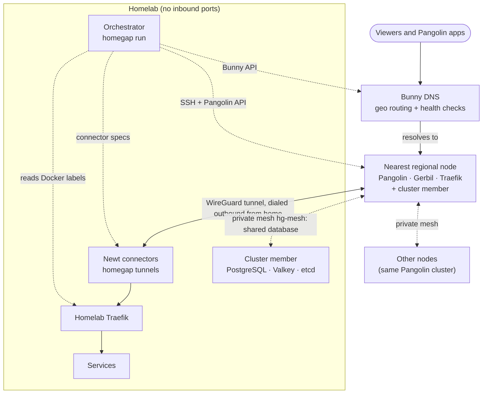

<div align="center">

<picture>
  <source media="(prefers-color-scheme: dark)" srcset="docs/img/brand/readme-header-dark.svg">
  
</picture>

Publish homelab services worldwide through your own regional edge nodes. No inbound ports, no third-party tunnel.

[](https://github.com/DrewCarlson/HomeGAP/actions/workflows/build.yml)
[](https://drewcarlson.github.io/HomeGAP/latest/)
[](LICENSE)
[](https://github.com/DrewCarlson/HomeGAP/pkgs/container/homegap)

**[Documentation](https://drewcarlson.github.io/HomeGAP/latest/)** ·
**[Getting started](https://drewcarlson.github.io/HomeGAP/latest/getting-started/)** ·
**[Label reference](https://drewcarlson.github.io/HomeGAP/latest/services/labels/)**

</div>

---

HomeGAP is a self-hosted alternative to Cloudflare Tunnels and WARP. Your homelab is the only
origin, and nothing at home accepts inbound connections. Regional VPS nodes take each viewer's
connection near the viewer and send it home through a WireGuard tunnel that the homelab dials out.

One orchestrator container on the homelab controls the system from Docker labels:

- **Regional nodes** are Ubuntu VPS servers from any provider, in any location. Each node runs
  [Pangolin](https://github.com/fosrl/pangolin) with Gerbil and Traefik.
- **[Bunny DNS](https://bunny.net/dns/)** sends each viewer to the nearest healthy node. Health
  checks remove a node that fails.
- **The orchestrator** reads the labels and creates the Pangolin resources on every node, the
  tunnels that connect the nodes to the homelab, and the DNS records. It also installs and
  maintains the nodes over SSH.

> [!CAUTION]
> HomeGAP is early-stage software. Test it on a domain that nothing depends on, for example a
> spare domain or a subdomain delegated to Bunny. Then move production traffic to it.

## Features

- **The origin stays hidden.** The homelab has no open ports. Every tunnel starts at home.
- **End-to-end TLS by default.** Nodes route by the TLS server name and never see plaintext. One
  label moves TLS termination to the nodes.
  ([Traffic paths](https://drewcarlson.github.io/HomeGAP/latest/services/traffic-paths/))
- **HTTP(S), raw TCP and UDP**, and private services that only the Pangolin client can reach.
  ([Services](https://drewcarlson.github.io/HomeGAP/latest/services/))
- **Geo routing with failover.** Each viewer reaches the nearest healthy node.
  ([DNS routing and health checks](https://drewcarlson.github.io/HomeGAP/latest/configuration/dns/))
- **A VPN that keeps working when the homelab is down.** In cluster mode, all nodes are one
  Pangolin with shared users and devices. The Pangolin apps connect through the nearest node,
  and sign-in continues to work while the homelab is offline.
  ([Cluster mode](https://drewcarlson.github.io/HomeGAP/latest/cluster/))
- **Real client addresses and private-only services.** The homelab sees each viewer's address,
  and a Traefik allowlist can admit only Pangolin clients.
  ([Client addresses](https://drewcarlson.github.io/HomeGAP/latest/services/client-addresses/))
- **One label publishes a service.** Docker labels are the source of truth. The orchestrator
  makes the rest match them.
- **Node lifecycle from a bare VPS.** A dashboard wizard turns a fresh server into a node over
  SSH. Updates roll out one node at a time, with automatic rollback.
  ([Add a node](https://drewcarlson.github.io/HomeGAP/latest/getting-started/add-node/))
- **A built-in dashboard** for health, pausing, re-provisioning, speed tests, diagnostics and
  node management. It also serves the documentation for its own version.
  ([The dashboard](https://drewcarlson.github.io/HomeGAP/latest/operations/dashboard/))
- **Self-hosted maps** of the nodes and the homelab, on the dashboard and on an optional public
  status page. No third-party map service.
  ([Maps and locations](https://drewcarlson.github.io/HomeGAP/latest/operations/maps/))
- **The orchestrator is never in the traffic path.** If it stops, the nodes continue to serve,
  the tunnels stay up and DNS continues to resolve. You can manage each part by hand: SSH, each
  node's Pangolin dashboard, or the Bunny console.

## How it works

Solid arrows are viewer traffic. Dashed arrows are the orchestrator's control plane.



A viewer's request goes to the node that DNS picks. The node reads only the TLS server name and
sends the encrypted stream through the tunnel to your homelab Traefik, which ends TLS as it does
today. The cluster parts (the shared database and the mesh) exist only in cluster mode.
[How HomeGAP works](https://drewcarlson.github.io/HomeGAP/latest/getting-started/how-it-works/)
explains each step.

## A quick look

Label your homelab Traefik as the front door. The root and every name one label under the domain
that it serves are then published through the nodes, with no more labels:

```yaml
traefik:
  labels:
    homegap.expose: "example.net"
    homegap.wildcard: "true"
    homegap.protocol: "https"
    homegap.tls: "passthrough"   # change to "terminate" to end TLS on the nodes
```

Other services need labels only when they need their own path, for example a game server on a
public UDP port in one region:

```yaml
game:
  labels:
    homegap.expose: "game.example.net"
    homegap.protocol: "udp"
    homegap.port: "27015"
    homegap.regions: "eu1"
```

The [label reference](https://drewcarlson.github.io/HomeGAP/latest/services/labels/) lists every
label.

## Get started

You need Docker and Traefik on the homelab, one Ubuntu VPS for each region, and a Bunny DNS zone.
See the [requirements](https://drewcarlson.github.io/HomeGAP/latest/getting-started/requirements/).

1. [Choose standalone or cluster mode](https://drewcarlson.github.io/HomeGAP/latest/getting-started/choose-a-mode/).
2. [Prepare Bunny DNS](https://drewcarlson.github.io/HomeGAP/latest/getting-started/bunny-dns/).
3. [Prepare the servers](https://drewcarlson.github.io/HomeGAP/latest/getting-started/servers/).
4. [Install on the homelab](https://drewcarlson.github.io/HomeGAP/latest/getting-started/install/).
5. [Add a node](https://drewcarlson.github.io/HomeGAP/latest/getting-started/add-node/).
6. [Publish a service](https://drewcarlson.github.io/HomeGAP/latest/getting-started/first-service/).

The image `ghcr.io/drewcarlson/homegap` is published for `linux/amd64` and `linux/arm64`.

## Documentation

| Section | What it covers |
| --- | --- |
| [Getting started](https://drewcarlson.github.io/HomeGAP/latest/getting-started/) | The concepts, the requirements and the setup from start to finish. |
| [Services](https://drewcarlson.github.io/HomeGAP/latest/services/) | Labels, traffic paths, raw ports, private services, sign-in, client addresses. |
| [Cluster mode](https://drewcarlson.github.io/HomeGAP/latest/cluster/) | The mesh, the shared database, users and devices, the Pangolin apps, exit nodes. |
| [Configuration](https://drewcarlson.github.io/HomeGAP/latest/configuration/) | Every config key, secrets, certificates, DNS, Pangolin EE licenses. |
| [Operations](https://drewcarlson.github.io/HomeGAP/latest/operations/dashboard/) | The dashboard, updates, upgrades, troubleshooting, failure modes, performance. |
| [Reference](https://drewcarlson.github.io/HomeGAP/latest/reference/cli/) | The command line, the HTTP API, the security model, ports, files. |
| [Development](https://drewcarlson.github.io/HomeGAP/latest/development/building/) | Building from source, the end-to-end tests, the documentation. |

## Security

The orchestrator holds every SSH key and API key, so run it on a minimal host and keep its
dashboard private. The [security model](https://drewcarlson.github.io/HomeGAP/latest/reference/security/)
gives the details.

To report a security issue, open a private
[security advisory](https://github.com/DrewCarlson/HomeGAP/security/advisories/new). Do not open
a public issue.

## Contributing

Issues and pull requests are welcome. Before you open a pull request, make sure that the unit
tests pass (`./gradlew macosArm64Test :presentation:jsNodeTest`). For changes to provisioning, routing or DNS, the
[end-to-end tests](https://drewcarlson.github.io/HomeGAP/latest/development/e2e/) must also pass.
[Build from source](https://drewcarlson.github.io/HomeGAP/latest/development/building/) tells you
how to build and test HomeGAP.

## Acknowledgements

HomeGAP builds on [Pangolin](https://github.com/fosrl/pangolin), Newt and Gerbil by Fossorial,
[Traefik](https://traefik.io/) and [Bunny DNS](https://bunny.net/dns/).

## AI assistance

HomeGAP was built with AI assistance. The architecture and system design were created by a
human, and the core security code was written by a human. The rest of the implementation was
written with AI assistance under human direction and review.

## License

HomeGAP is released under the [MIT License](LICENSE).

Pangolin is subject to its own license terms. Two HomeGAP features need Pangolin EE: cluster
mode, and wildcard resources with TLS ended on the nodes (`terminate`). Pangolin EE is free for
personal use and for organizations below its commercial revenue threshold.
