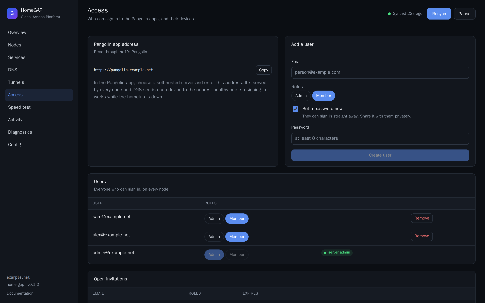
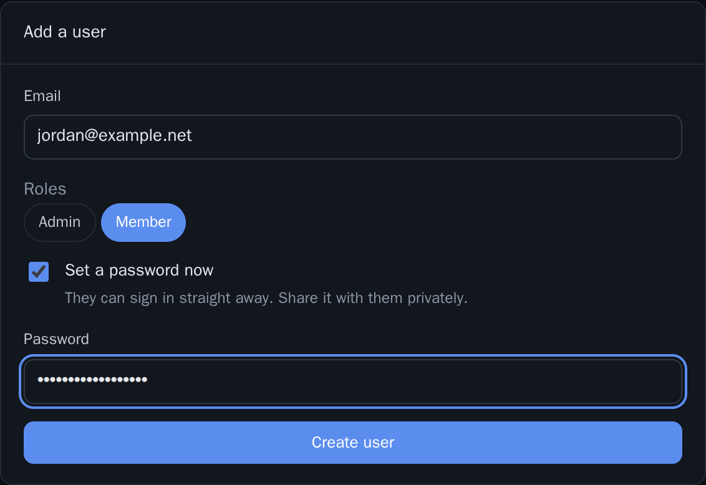
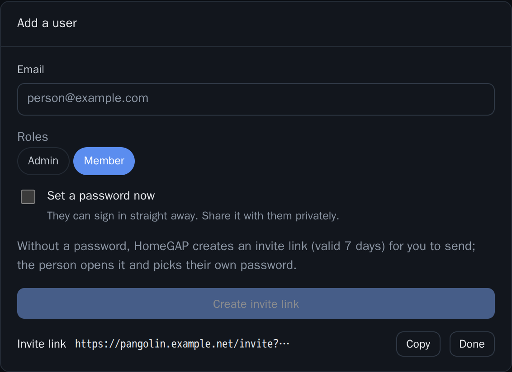
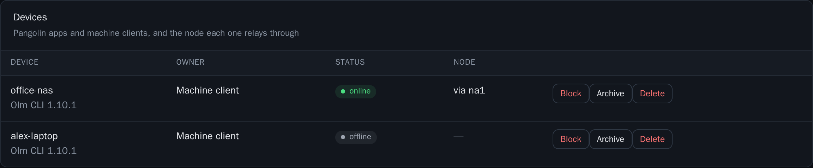

# Users and devices

The **Access** page manages the people who can sign in to the Pangolin apps, and their devices. This page tells you how to use it.

The page is available only in cluster mode. Its subtitle is "Who can sign in to the Pangolin apps, and their devices". You do not sign in to Pangolin as the admin.

## How changes reach Pangolin

All nodes share one database. Thus HomeGAP sends each change through the Pangolin of any node that it can reach. The page shows the node, for example "Read through na1's Pangolin". HomeGAP writes each change to the reconcile log.

The first time, HomeGAP gives its API key the permissions that the page needs. This takes one admin login.

## The Pangolin app address

The **Pangolin app address** panel shows `https://<client_hostname>.<domain>`. Click **Copy**, and give the address to your users. In the Pangolin app, they add it as a self-hosted server. See [Connect the Pangolin apps](pangolin-apps.md).

## Add a user

1. In **Add a user**, type the email address in **Email**.
2. Under **Roles**, select one or more roles. A new user has the role with the least privilege by default.
3. Select how the user gets a password. Do one of the procedures below.

The page shows "Pick at least one role" if you do not select a role.

### With a password

1. Select **Set a password now**. The text tells you "They can sign in straight away. Share it with them privately."
2. In **Password**, type a password with at least 8 characters.
3. Click **Create user**.
4. Give the password to the user on a private channel.

### With an invite link

1. Clear **Set a password now**.
2. Click **Create invite link**. The page shows the **Invite link**.
3. Click **Copy**.
4. Send the link to the person. The link is valid for 7 days. The person opens it and chooses a password.

## Users

The **Users** panel shows "Everyone who can sign in, on every node".

- To change the roles of a user, click the role buttons in the **Roles** column.
- To remove a user, click **Remove**. Then confirm. The user can no longer sign in, and the devices of the user stop.

The server admin account that HomeGAP creates has the badge **server admin**. You cannot remove this user here.

The **Open invitations** panel shows the invitations that nobody has used yet, with their **Expires** time. To withdraw an invitation, click **Remove**.

## Devices

The **Devices** panel shows "Pangolin apps and machine clients, and the node each one relays through". For each device, the table shows:

- **Device**: the name of the device.
- **Owner**: the email of the person, or **Machine client**.
- **Status**: for example `online`, `offline`, `blocked` or `archived`.
- **Node**: the node that the device relays through.

You can do these actions on a device:

- **Block** or **Unblock**. For **Block**, the page asks you to confirm.
- **Archive** or **Restore**.
- **Delete**. The page asks you to confirm.

## Roles

Use the names of Pangolin roles in these settings:

- `homegap.roles`, for private services, `auth=sso` and private paths. See the [Label reference](../services/labels.md).
- `cluster.exit_nodes.roles`, for the exits. See [Exit nodes](exit-nodes.md).

The `Admin` role can reach everything.

## API

The page uses these API routes. See [HTTP API](../reference/api.md).

| Route | What it does |
| --- | --- |
| `GET /api/access` | Returns the users, invitations, devices and roles. |
| `POST /api/access/users` | Creates a user, or an invitation. |
| `DELETE /api/access/users/{id}` | Removes a user. |
| `PUT /api/access/users/{id}/roles` | Sets the roles of a user. |
| `DELETE /api/access/invitations/{id}` | Removes an invitation. |
| `POST /api/access/devices/{id}/{action}` | Does an action on a device: `block`, `unblock`, `archive`, `unarchive` or `delete`. |
