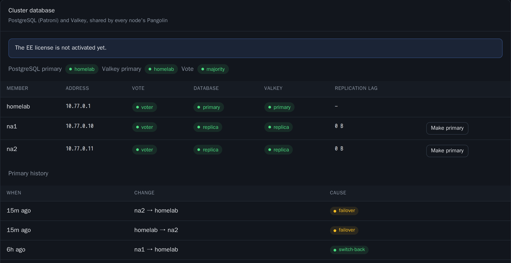

# Cluster database

The cluster database holds the data of the clustered Pangolin. This page tells you how the members elect a primary, how failover and switch-back work, and how to read the **Cluster database** panel.

## The members

The homelab and every node run one member of the database. The containers come from the `homegap-cluster` image:

| Container | Nodes | Homelab |
| --- | --- | --- |
| etcd (the vote) | Yes | Yes (`homegap-etcd`) |
| PostgreSQL under Patroni | Yes | Yes (`homegap-db`) |
| Valkey | Yes | Yes (`homegap-valkey`) |
| Valkey Sentinel | Yes | Yes (`homegap-sentinel`) |
| HAProxy (`cluster-proxy`) | Yes | No |
| The mesh probe | Yes | No |

Thus each node runs five cluster containers plus the probe, and the homelab runs four.

Each node member is its own compose project in `/opt/homegap/cluster`, under `pangolin.install_dir`. It is separate from the Pangolin stack, so a stack update never restarts the database. When you remove a node, HomeGAP removes its member from the vote and deletes its data. The Valkey Sentinels never forget a member by themselves. While one still knows a removed member, it uses a full CPU core, so HomeGAP has it forget the member (`SENTINEL RESET`), one Sentinel at a time and at least 30 seconds apart. The log then shows "Sentinel forgot departed" and the member's address.

## The homelab as a vote only

By default, the homelab is a full member. It holds a copy of the database and is the primary when it can.

With `cluster.homelab_role: vote`, the homelab only votes. It runs etcd and Valkey Sentinel, and it runs no PostgreSQL and no Valkey. The `homegap-db` and `homegap-valkey` containers wait and do nothing. The database and Valkey are on the nodes only:

- The nodes elect the primary between them. The vote of the homelab gives two nodes a majority when one node fails.
- There is no preferred member and no switch-back. The primary stays where the vote puts it.
- Once a day, HomeGAP makes a dump of the database on a node. It keeps the newest seven in `cluster/backups` in the data directory of the orchestrator.
- `homegap maintenance start` moves nothing, because the homelab holds no primary.

Each node is a member of the database, and members share their settings. Thus a person with root on a node can run commands in each container that runs a database member. In this mode, no such container is on the homelab. Use it if you do not trust your nodes as much as your homelab. The price is that the live data is on the nodes, not at home.

!!! warning "Caution"
    Set `homelab_role` before the first start of the cluster. HomeGAP records the role when it creates the cluster. If you change the value later, the cluster part of each pass fails until you set it back.

With this role, use two or more nodes. With one node, the database has no second copy.

## The primary

The homelab is the primary. It starts the cluster. The nodes then join one at a time: first the vote, then as `streaming` replicas.

### Failover

If the homelab drops off the mesh, the nodes that still reach a majority of the vote promote one of themselves. This takes approximately 30 seconds.

A member that loses the majority demotes itself. This also applies to the homelab, if the homelab is the member that is cut off. Thus two primaries never accept writes at the same time.

The vote needs a majority. To keep the cluster in operation without the homelab, you need two or more nodes.

### Switch-back

When the homelab comes back, it joins again as a replica. It rewinds the writes that it accepts after the loss of the vote. After the homelab stays caught up for `cluster.primary.switch_back_after` (default 10 minutes), HomeGAP moves the PostgreSQL primary back to it. Then it moves the Valkey primary.

### Make a member the primary

On the **Cluster database** panel, a caught-up replica has a **Make primary** button. This is a planned switchover. Writes stop for a second or two, and HomeGAP loses no data. If the new primary is not where the primary belongs, the switch-back returns it after the hold.

The API call is `POST /api/cluster/switchover` with the body `{"to": "<member>"}`.

## How services find the primary

On each node, the containers on the `homegap-cluster` Docker network connect to HAProxy:

- PostgreSQL at `cluster-proxy:5433`.
- Valkey at `cluster-proxy:6380`.

HAProxy follows the current primary. It cuts the connections to a member that demotes itself. The stats page of HAProxy listens only on `127.0.0.1:8404` of the node.

### The cluster-proxy check

Each node has a `cluster-proxy` check. It shows where HAProxy sends PostgreSQL and Valkey. It also shows how many times HAProxy had no primary in the last hour, and the time of the last loss.

| State | When |
| --- | --- |
| Red | A primary has no member that HAProxy can reach. |
| Yellow | For 5 minutes after a loss that HomeGAP did not plan. |
| Green | All other times. |

A switch that HomeGAP plans also leaves HAProxy without a primary for a moment. Examples are a switch-back, maintenance, a node update and a switch from the dashboard. The check shows "planned switch N min ago", but it stays green.

## Settings, passwords and backups

PostgreSQL runs without JIT compilation. Pangolin makes only small lookups, and a connection that uses JIT keeps approximately 40 MB.

A change to the settings does not restart the database. Patroni reads `patroni.yml` again. The settings that need a restart of PostgreSQL show as pending. The `db` container of the homelab reads a changed file within ten seconds.

Pangolin uses the database `pangolin` with the role `pangolin`, which owns that database and is not a superuser. The homelab member creates both when it creates the cluster. The superuser `postgres` can sign in only from inside a member. Replication uses the role `replicator`, and `pg_rewind` uses the role `rewinder`.

HomeGAP creates the passwords one time and keeps them in `cluster/secrets.json` in the data directory. The database keeps the passwords from its creation, so HomeGAP never creates new ones for a cluster that runs. If the file is gone or damaged, the cluster part of each pass fails until you restore the file. Keep a backup of it.

The homelab member writes a nightly `pg_dump` to `./backups`, next to the homelab compose file (`HG_BACKUP_DIR: /backups`). It keeps the newest seven.

## Backup and restore

### What to keep

A dump holds the database `pangolin`: the users, the devices, the sites and the resources of Pangolin. To restore a homelab, keep these items together:

- The dumps in `./backups`. With `cluster.homelab_role: vote`, they are in `cluster/backups` in the data directory.
- The data directory of the orchestrator (the `homegap-data` volume). It holds the state cache, the cluster passwords and the ACME account.
- The config file.

The dumps are on the same disk as the database of the homelab. Copy them to a different machine at regular intervals.

!!! danger "Warning"
    A dump is not encrypted. It contains the email addresses and the password hashes of your Pangolin users. Encrypt each copy that leaves the homelab.

This command makes one encrypted file from the dumps. It reads the passphrase from a file:

```bash
tar -cz backups | openssl enc -aes-256-cbc -pbkdf2 -salt -pass file:backup.pass -out homegap-backups.tar.gz.enc
```

### Check that a dump restores

Do this check from time to time. It restores the newest dump into an empty database and then removes that database. The primary must be on the homelab.

```bash
docker compose exec homegap-db sh -c 'gosu postgres createdb -h /var/run/postgresql -U postgres hg_restore_check \
  && gosu postgres pg_restore -h /var/run/postgresql -U postgres --no-owner -d hg_restore_check "$(ls -1t /backups/homegap-*.dump | head -n 1)" \
  && gosu postgres psql -h /var/run/postgresql -U postgres -d hg_restore_check -Atc "select count(*) from information_schema.tables where table_schema = '"'"'public'"'"'"; \
  gosu postgres dropdb -h /var/run/postgresql -U postgres hg_restore_check'
```

The command prints the number of tables in the dump. A number above zero and no error show that the dump is good.

### Restore a dump

A restore replaces the contents of the database `pangolin` with the contents of the dump. Each change after the time of the dump is lost.

1. On the dashboard, click **Pause**. HomeGAP then makes no changes.
2. In the **Cluster database** panel, make sure that the primary is on the homelab. If it is not, click **Make primary** on the homelab member.
3. On each node, stop Pangolin:
    ```bash
    docker stop pangolin
    ```
4. On the homelab, restore the dump. Replace the file name:
    ```bash
    docker compose exec homegap-db gosu postgres pg_restore -h /var/run/postgresql -U postgres --clean --if-exists -d pangolin /backups/homegap-20261101T030000Z.dump
    ```
5. On each node, start Pangolin:
    ```bash
    docker start pangolin
    ```
6. On the dashboard, click **Resume**.

The members on the nodes follow the primary. They need no restore.

With `cluster.homelab_role: vote`, the database is on the nodes. Copy the dump to the node that holds the primary. Then run `pg_restore` in the `db` container of that node, in `/opt/homegap/cluster`, with the same options.

!!! warning "Caution"
    After a restore, a node that you added after the time of the dump has no site in Pangolin. HomeGAP creates the site again on the next pass, and the tunnel of that node reconnects.

## Maintenance of the homelab member

Before you work on the homelab member, move the primaries to the nodes. Run this command:

```bash
docker compose exec orchestrator homegap maintenance start
```

The command does these steps:

1. If a node updates its own member, the command waits for it, for up to 10 minutes.
2. It moves the PostgreSQL primary to a node with a planned switchover.
3. It moves the Valkey primary to a node with a Sentinel failover.
4. It waits until both primaries are on the nodes.
5. It holds them there, with no switch-back, until you end maintenance. The hold stops after `--minutes N` at most (default 30).

To end the hold, run this command:

```bash
docker compose exec orchestrator homegap maintenance end
```

After the end, the usual switch-back applies. `deploy/upgrade.sh` uses these commands. See [Upgrade the homelab](../operations/upgrade.md).

## Updates of the node members

After an upgrade of the homelab, the members on the nodes follow the image of the homelab. HomeGAP pins the image to its registry digest. It updates one node in each pass, and only while every member serves and no maintenance runs.

Each node does these steps:

1. It pulls the image.
2. It moves any primary that it holds to the homelab.
3. It restarts its services one at a time. Each service must serve again before the next one restarts.

The log tells you when and why the update of a node waits.

## The Cluster database panel

The **Nodes** page has a **Cluster database** panel, with the subtitle "PostgreSQL (Patroni) and Valkey, shared by every node's Pangolin".

The panel shows the **PostgreSQL primary**, the **Valkey primary** and the state of the **Vote**. A banner tells you when a pending switch-back is due. For each member, the table shows:

- **Vote**: the etcd state of the member.
- **Database**: the PostgreSQL role.
- **Valkey**: the Valkey role.
- **Replication lag**: how far the replica is behind the primary.



### Alerts

The panel shows an alert in these cases:

- The vote has no majority, or there is no primary. With no majority, the **Vote** pill tells you "No primary can be elected until enough members are back".
- A member is cut off from the others, by its mesh handshakes or by its vote.
- A replica is more than 16 MiB behind the primary.
- There are fewer than two nodes. Then the cluster cannot elect a primary without the homelab.
- The state of the EE license.

### Primary history

The **Primary history** table shows each change of the primary and its cause:

| Cause | Description |
| --- | --- |
| `failover` | "Elected by the cluster when the primary was lost" |
| `switch-back` | "Moved back by HomeGAP after the hold" |
| `maintenance` | "Moved off the homelab before an upgrade" |
| `manual` | "Switched from the dashboard" |
| `first seen` | "The primary when HomeGAP started recording" |

## Failures

| Failure | Effect | Recovery |
| --- | --- | --- |
| The node with the primary is down. | Sign-ins and changes stop for approximately 30 seconds, while the other members elect a new primary. DNS moves public traffic as for any node. | Automatic. The primary returns to the homelab after the hold. |
| The homelab is up, but cut off from the nodes. | The homelab loses the vote and stops all writes. The nodes elect a primary and continue to serve. | Repair the link. The homelab joins again as a replica and rewinds the writes that it cannot keep. The primary moves back after the hold. |
| The mesh link between two nodes is broken. | Nothing is visible while a majority of members still reach each other. The dashboard shows the isolated member. | Repair the network. WireGuard connects again by itself. |
| Fewer than half of the members are reachable. | The cluster cannot elect a primary. Sign-in and changes fail. Connected apps and public traffic continue to work. | Bring the members back. The dashboard shows "no majority". |
