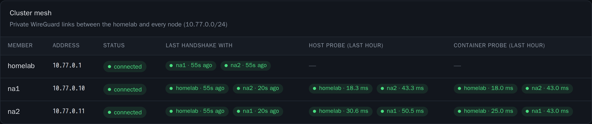

# Cluster mesh

The cluster mesh is the private network of the cluster. This page tells you how the mesh works and how to read the **Mesh** panel.

## What the mesh is

`hg-mesh` is a private WireGuard mesh between the homelab and every node. Cluster traffic uses only this mesh: the database, Valkey and the node API of Gerbil.

The addresses are fixed. The homelab is host 1 of `cluster.mesh.subnet`. A node is host `10 + slot`, where the slot is the permanent tunnel slot of the node. With the default subnet, the homelab is `10.77.0.1` and the first node is `10.77.0.10`.

## Keys and connections

Each node creates its own key during its first setup. The private key stays on the node. HomeGAP knows only the public key.

The homelab can be behind NAT. It dials every node and keeps the paths open, so HomeGAP never publishes its address. The nodes connect to each other directly on their public addresses.

The firewall of each node opens `cluster.mesh.port`/udp to anywhere. WireGuard authenticates every packet, and the address of the homelab can change. On the mesh interface, the firewall accepts only the ports of the cluster services. A member cannot reach SSH or other ports of a node through the mesh.

On the homelab end of the mesh, HomeGAP drops inbound traffic, except replies, ping and the ports of the cluster database. Thus the nodes reach only the cluster services of the homelab.

## The interfaces

On each node, `wg-quick` manages the interface, and it starts at boot. Changes to the peers apply in place. They do not drop the sessions.

On the homelab, the interface is in the network namespace of the `homegap-mesh` container. The cluster containers of the homelab share this namespace. The orchestrator is not in it. `deploy/upgrade.sh` never recreates `homegap-mesh`, so the interface stays up during an upgrade.

The `homegap-mesh-agent` container manages the interface. The orchestrator writes the description of the mesh to the `homegap-mesh` volume. The agent applies it. Then it writes its public key and the state of each peer to the same volume. The private key of the homelab stays in that volume.

## The isolation of the homelab member

Each node is a member of the cluster database, so HomeGAP treats the namespace of `homegap-mesh` as reachable from the nodes. The agent keeps a firewall there that refuses everything except these connections:

- Into the namespace: replies, ping and the ports of the cluster database.
- Out of the namespace: the mesh, replies and WireGuard to the nodes.
- Through the namespace: the orchestrator to the members on the mesh, and the replies.

Thus a container in that namespace cannot open a connection to the orchestrator, to your other containers or to your home network. The agent installs the firewall before it starts the interface. If the firewall fails, the mesh stays down.

The orchestrator reaches the members through this namespace. It adds a route for `cluster.mesh.subnet` through `homegap-mesh` on the `homegap-cluster` network. For that route it needs `NET_ADMIN`.

## What a container on a node can reach

Pangolin on a node faces the internet. HomeGAP keeps the containers of a node away from the services that control the cluster:

- The firewall of the node admits the containers only to PostgreSQL, Valkey and the health check of Patroni on the member of their own node.
- A forward rule in the `DOCKER-USER` chain drops packets from a container to two ports of another member. The ports are the etcd peer port (`2380`) and the Sentinel port (`26379`). Docker forwards a container to the mesh as the node itself, so the other member sees no difference between them. The rule is on the node that sends. `wg-quick` adds it again at boot.
- etcd needs a password. The etcd client port (`2379`) stays reachable for the probe of HAProxy, but each read and each write needs the etcd `root` user. Only the members and the orchestrator hold that password.
- Sentinel needs a password. It is not the Valkey password, which Pangolin holds.

A person with root on a node holds these passwords, because the member of that node needs them. See [Security model](../reference/security.md#the-homelab).

## Probes

Once a second, each node opens a TCP connection to the etcd port of every other member. It does this on two paths:

- From the host, like etcd, Patroni and replication. A small `probe` container in the cluster member of the node does this on the host network. The node keeps the readings in `/run/homegap-probe`, so a reboot clears them.
- From inside the Docker network, through the checks of HAProxy. This is the path of the database and Valkey traffic of Pangolin, across the `homegap-cluster` bridge and its NAT.

Every node sends probes to the homelab. The homelab has no probe container. In each pass, the orchestrator sends one request to the Patroni of each node over the mesh. Thus the homelab row has a host probe with fewer samples, and no container probe.

## The Cluster mesh panel

The **Nodes** page has a **Mesh** panel. It is a matrix: each row is a member, and each column is a peer of that member. The note under the title shows how many links are up. Three buttons select what the cells show: **Host probe**, **Container probe** or **Handshake**.

With **Host probe** or **Container probe**, a cell shows:

- The latest round trip.
- The part of the probes lost in the last hour.
- The number of outages in the last hour. An outage is three or more lost probes in a row. The tooltip of the cell gives the start and the duration of each outage.

The color of a cell tells the state:

| Color | Meaning |
| --- | --- |
| Cyan | No outage in the last hour, and less than 0.5 % of the probes lost. |
| Amber | An outage in the last hour that is over, or 0.5 % or more of the probes lost. |
| Rose | The peer does not answer now, or 5 % or more of the probes lost. |

If only the container probe shows a problem, the link is good. The problem is then in the Docker network of that node.

With **Handshake**, a cell shows the time since the last WireGuard handshake with the peer. The color and the tooltip of the cell tell the state:

| Cell | Tooltip | Meaning |
| --- | --- | --- |
| Cyan | None. | The last handshake is 3 minutes old or less. |
| Amber | "No recent handshake" | The last handshake is 3 to 10 minutes old. |
| Rose | "No handshake for over 10 minutes" | The last handshake is more than 10 minutes old. |
| Rose, `never` | "No handshake yet" | The member has never had a handshake with the peer. |
| Rose, `not configured` | "Not in this member's peer list yet" | The member does not have this peer in its configuration yet. |
| Dim | "This member could not be read" | HomeGAP cannot read the state of the member. |

