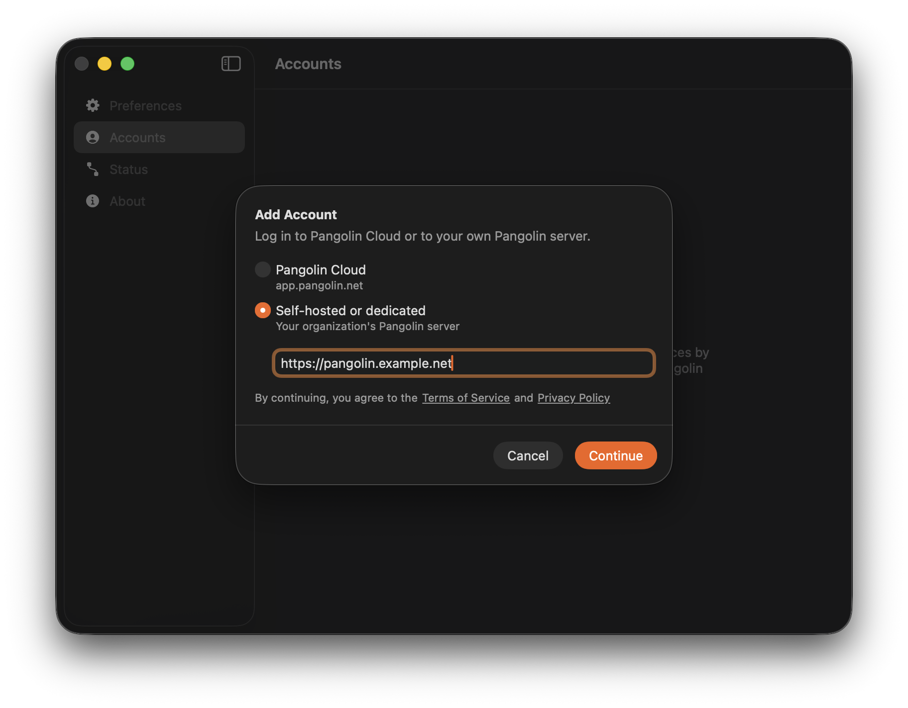
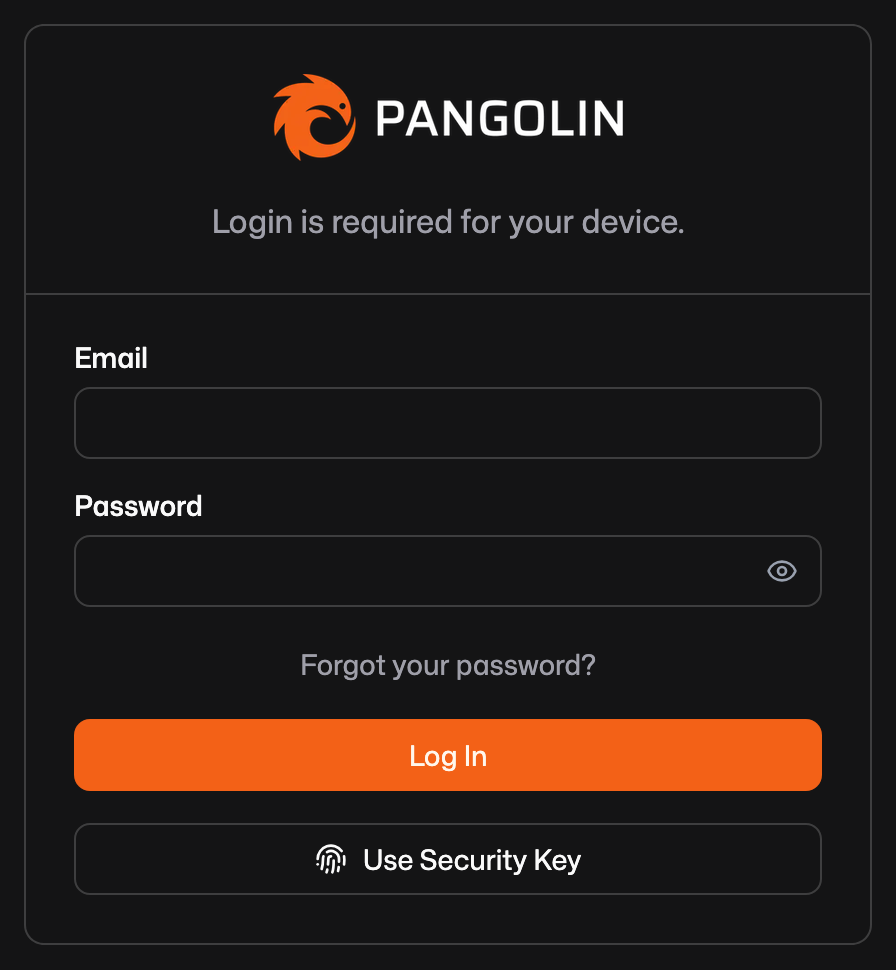
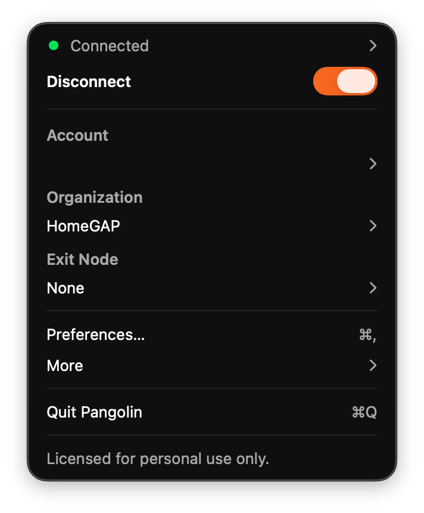

# Connect the Pangolin apps

The Pangolin app (by Fossorial) connects a device to your private services. This page tells you which address to use and how to connect a device.

## The server address

=== "Cluster"

    The server address is `https://pangolin.<domain>`. The **Access** page shows it as the **Pangolin app address**. Every node serves this address, and DNS sends each device to the nearest healthy node. The app selects the node when it connects or when it changes network.

=== "Standalone"

    Each node has its own Pangolin and its own users. The app connects to the management host of one node, `https://pangolin-<id>.<domain>`.

## Connect a device

1. Add the person on the **Access** page, with a password or an invite link. See [Users and devices](access.md).
2. If the person has an invite link, the person opens it and chooses a password.
3. The person installs the Pangolin app for their platform: [Android](https://pangolin.net/downloads/android), [iOS](https://pangolin.net/downloads/ios), [macOS](https://pangolin.net/downloads/mac), [Linux](https://pangolin.net/downloads/linux), [Windows](https://pangolin.net/downloads/windows), [CLI](https://pangolin.net/downloads/cli)
4. In the app, the person adds a self-hosted server and types the server address.

5. The person signs in with the email address and the password.

6. The person connects the app.

7. On the **Access** page, find the device in the **Devices** list. Make sure that it shows as `online`, with the node that it relays through.
8. Optional: if exit nodes are enabled, the person selects an exit in the app. See [Exit nodes](exit-nodes.md).
9. Optional: to send the DNS queries of the device through the tunnel, the person sets the DNS server in the app. See [DNS through the tunnel](#dns-through-the-tunnel).

## What the app reaches

A connected app reaches these services:

- The private services, by their hostnames. See [Private services](../services/private.md).
- The private paths of public services. See [Client addresses and private-only services](../services/client-addresses.md).

## DNS through the tunnel

The Pangolin app can send its DNS queries through the tunnel. HomeGAP opens the path to the DNS servers in `cluster.tunnel_dns.resolvers` (default `8.8.8.8`). You must set the same server in the app on each device. Pangolin has no setting that gives the server to the app.

1. Open the settings of the Pangolin app.
2. Enable **Enable Aliases (Override DNS)**.
3. Enable **DNS Over Tunnel**.
4. In **Primary Upstream DNS**, enter an address from `cluster.tunnel_dns.resolvers`.
5. Disconnect the app.
6. Connect the app again.

!!! warning "Caution"
    If **Primary Upstream DNS** is empty, the app uses the DNS server of the network of the device. HomeGAP opens no path to that server. With **DNS Over Tunnel** on, the device then resolves only the names of your private services, and other sites do not open.

With an exit node selected in the app, all traffic of the device uses the tunnel. Names then resolve also with an empty **Primary Upstream DNS**, so the problem shows only with no exit node.

For each setting of the app, see [Shared Preferences](https://docs.pangolin.net/manage/clients/platforms) in the Pangolin docs. On Android, also set **Private DNS** in the system settings to **Automatic** or **Off**. See [Android](https://docs.pangolin.net/manage/clients/platforms/android) in the Pangolin docs.

### The DNS servers that HomeGAP opens

HomeGAP makes each server in `cluster.tunnel_dns.resolvers` a private resource on port 53 (TCP and UDP). Its identifier is `hg-dns-<address>`, with `-` in the place of each dot or colon, for example `hg-dns-8-8-8-8`. The roles in `cluster.tunnel_dns.roles` can use it. A query to a server that is not in the list gets no answer.

- If `cluster.exit_nodes.nodes` is enabled, the resource is on the exit site of each node. The queries leave from the node that the device uses, the nearest node. Thus geo-steered names resolve to locations near the device.
- If not, the resource is on the homelab site of each node. The queries leave from your homelab.

To use a different server, for example `9.9.9.10`, set it in `cluster.tunnel_dns.resolvers` and in the app. See the [Configuration reference](../configuration/reference.md).

## While the homelab is down

The apps that are connected stay connected. New sign-ins work approximately 30 seconds later, when the nodes elect a database primary. Only the services on the homelab are not reachable.
