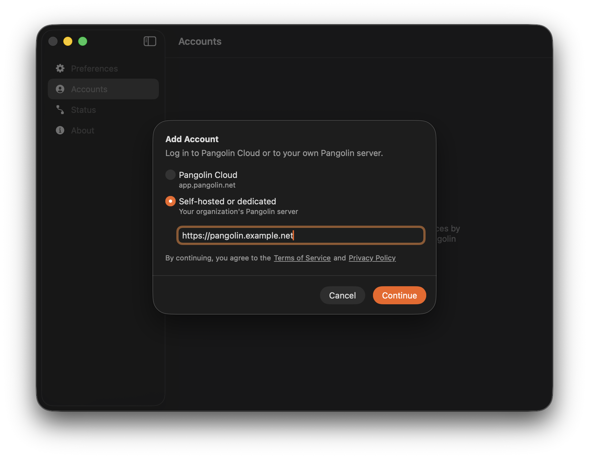
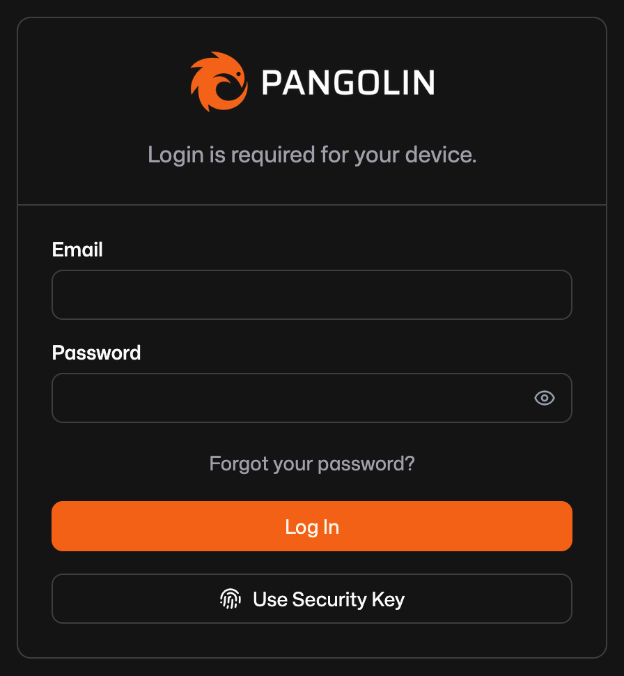
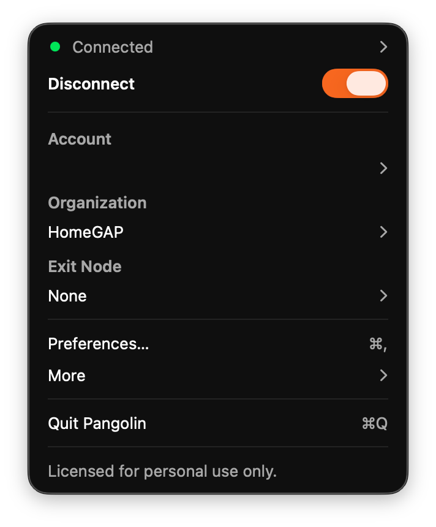

# Connect the Pangolin apps

The Pangolin app (by Fossorial) connects a device to your private services. This page tells you which address to use and how to connect a device.

## The server address

=== "Cluster"

    The server address is `https://pangolin.<domain>`. The **Access** page shows it as the **Pangolin app address**. Every node serves this address, and DNS sends each device to the nearest healthy node. The app selects the node when it connects or when it changes network.

=== "Standalone"

    Each node has its own Pangolin and its own users. The app connects to the management host of one node, `https://pangolin-<id>.<domain>`.

## Connect a device

1. Add the person on the **Access** page, with a password or an invite link. See [Users and devices](access.md).
2. If the person has an invite link, the person opens it and chooses a password.
3. The person installs the Pangolin app for their platform: [Android](https://pangolin.net/downloads/android), [iOS](https://pangolin.net/downloads/ios), [macOS](https://pangolin.net/downloads/mac), [Linux](https://pangolin.net/downloads/linux), [Windows](https://pangolin.net/downloads/windows), [CLI](https://pangolin.net/downloads/cli)
4. In the app, the person adds a self-hosted server and types the server address.

5. The person signs in with the email address and the password.

6. The person connects the app.

7. On the **Access** page, find the device in the **Devices** list. Make sure that it shows as `online`, with the node that it relays through.
8. Optional: if exit nodes are enabled, the person selects an exit in the app. See [Exit nodes](exit-nodes.md).

## What the app reaches

A connected app reaches these services:

- The private services, by their hostnames. See [Private services](../services/private.md).
- The private paths of public services. See [Client addresses and private-only services](../services/client-addresses.md).

## While the homelab is down

The apps that are connected stay connected. New sign-ins work approximately 30 seconds later, when the nodes elect a database primary. Only the services on the homelab are not reachable.
