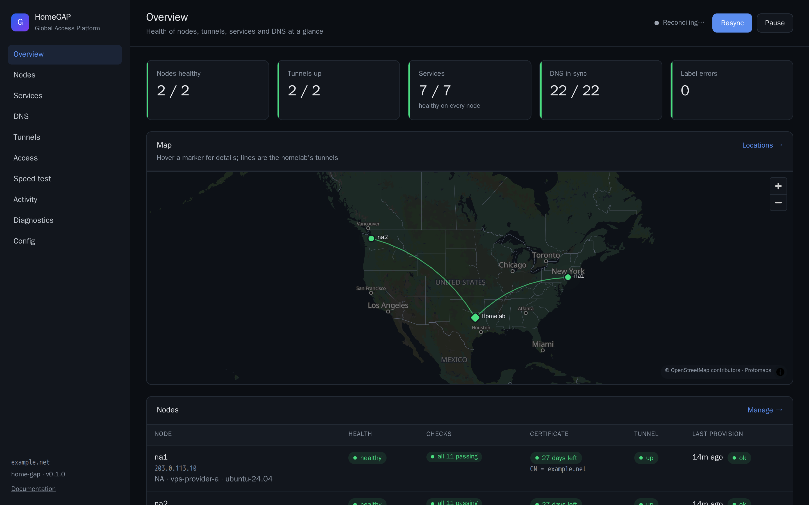
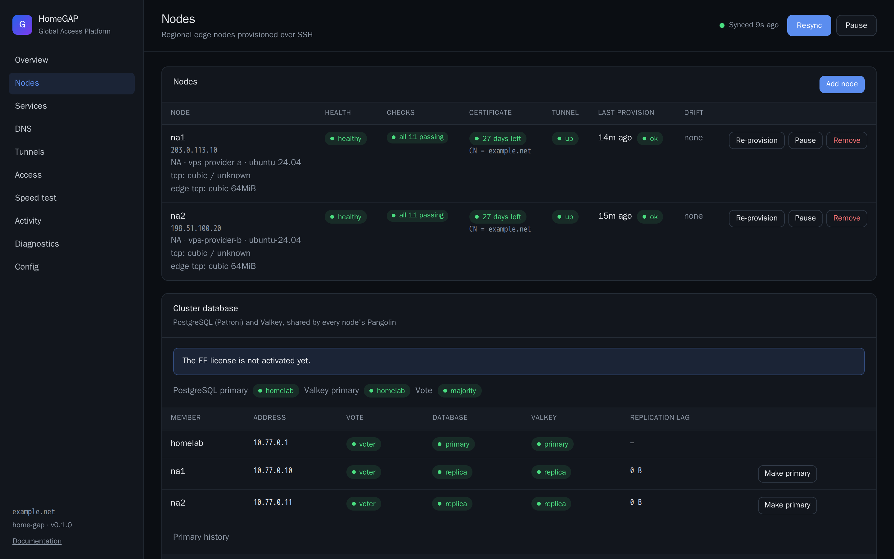
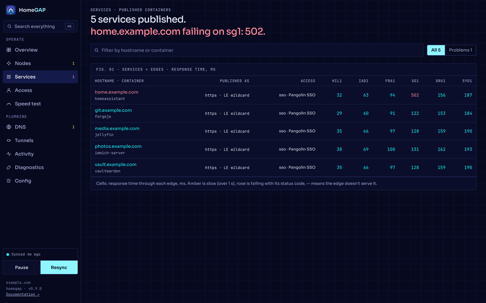
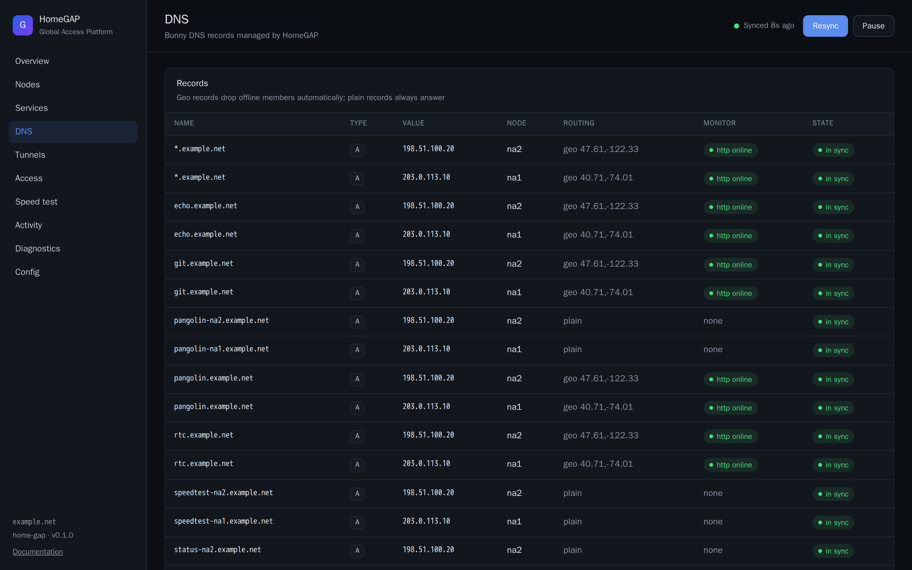
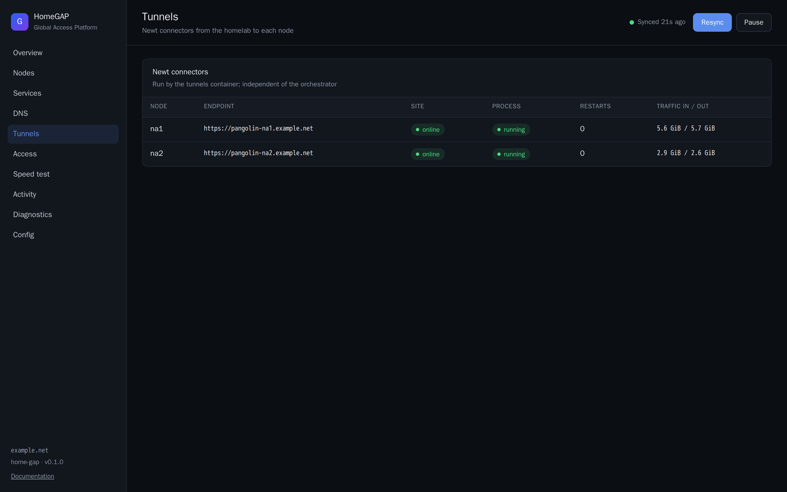
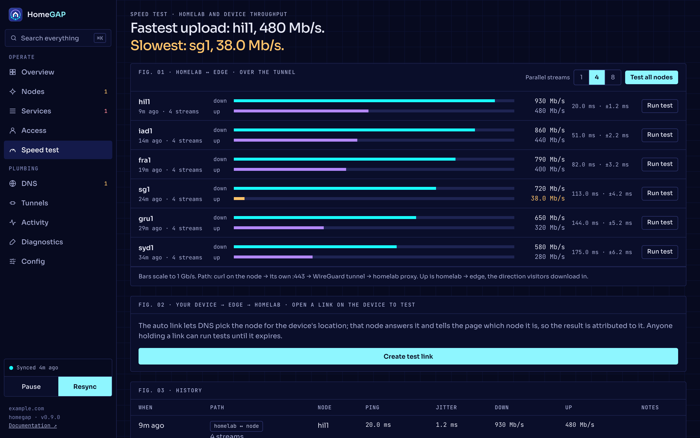
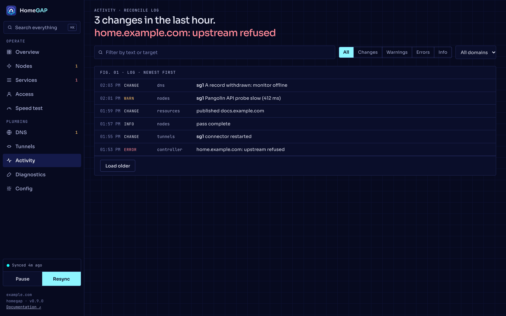
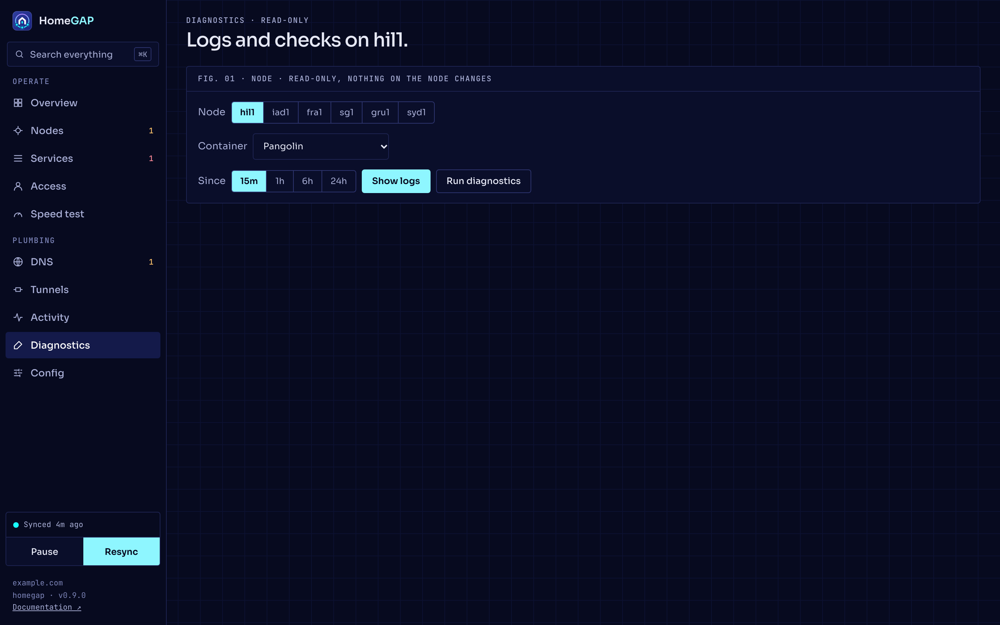
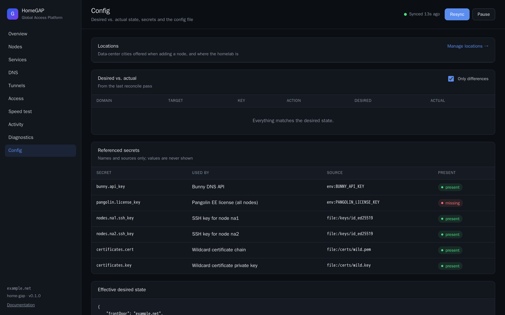

# The dashboard

The orchestrator serves a dashboard on `dashboard.bind`. This page tells you how to reach it safely and what each page shows.

!!! danger "Warning"
    If the dashboard is public, anybody can control every node. Reach it only through a private Pangolin resource or an SSH tunnel. See [Private services](../services/private.md).

## Access

A bearer token protects every `/api` route. Set it with `dashboard.auth_token_env` or `dashboard.auth_token_file`. If the config names no token, or the token is not available, HomeGAP creates one. It keeps that token in the file `dashboard-token` in its data directory, with mode 0600. To read the token, run this command:

```bash
docker compose exec orchestrator cat /data/dashboard-token
```

The dashboard asks for the token in a sign-in dialog and keeps it in the browser. A change of the token needs a restart of the orchestrator.

To remove the token from the browser, click **Sign out** at the bottom of the menu, or search for "Sign out". Do this on a computer that other people use.

The dashboard updates live. It uses one server-sent event stream (`/api/events`). After the first snapshot, the stream sends only the parts that change. When the browser tab is hidden for 30 seconds, the dashboard closes the stream. It opens the stream again when you return to the tab.

The orchestrator writes to the stream every 25 seconds or less. If the dashboard gets nothing for 60 seconds, it opens a new stream. The orchestrator keeps 32 streams open at most. A dashboard above that number gets an error until a different one closes.

If the dashboard cannot reach the orchestrator for more than 5 seconds, a dialog says so. The dialog shows the error and the time to the next try, and it has **Reconnect now**. It closes by itself when the orchestrator answers again. Until then, the page shows the last data from the orchestrator.

## The layout

The menu has two groups: **Operate** (Overview, Nodes, Services, Access, Speed test) and **Plumbing** (DNS, Tunnels, Activity, Diagnostics, Config). A number next to a page is the count of items that need attention there. On a tablet the menu is a rail of icons. On a phone it is a grid of icons under the header, which gets smaller when you scroll.

The box at the bottom of the menu shows the last pass, and two controls:

- **Resync** queues a pass now.
- **Pause** stops all changes everywhere. HomeGAP then only observes, and every page shows a banner with **Resume**. While changes are paused, the box offers **Run one pass**: one pass that applies changes, after which HomeGAP is paused again. A re-provision or a switch of the primary while paused asks if you want to apply just that change or resume everything.

Each page starts with a headline that states the answer, for example "5 of 6 edges healthy.". Under it, a status line shows the most important message. When there are more, **+N more** opens all of them.

Select a node, a service or another item to open it in the **Inspector**. On a wide screen the Inspector is a column on the right. On a narrower screen it is a drawer, and on a phone it is a sheet at the bottom. The Inspector holds the actions for the item. Esc, the close button or the back button closes it. On a phone you can also drag the sheet down.

Press ⌘K, Ctrl+K or `/` to search everything: nodes, services, DNS records, tunnels, pages, actions such as **Resync now**, and on the orchestrator the log, the config keys and the secrets. The search shows the names of config keys and secrets, never their values.

Actions that are risky ask first. To remove a node or a person, you type its name. After you remove a node or a person, a message with **Undo** shows for 30 seconds. A later message does not replace it. **Dismiss** removes it. A removed person stays until then, and **Undo** keeps them. **Undo** on a removed node adds it back with its config.

## The pages

### Overview

The whole system at a glance:

- The gauges: edges, tunnels, services, DNS, and in cluster mode the mesh links and the replica lag.
- **Needs attention**: what is wrong now, worst first. Select an item to inspect it.
- The network: the traffic path (homelab, tunnels, edges, names) or the map. The page remembers your choice. See [Maps and locations](maps.md).
- Each edge's Pangolin API probe over the last hour.
- Each service through each edge, in milliseconds.
- The system and the recent changes.



### Nodes

The fleet table shows each node's health, its checks, its Pangolin API probe over the last hour, its tunnel, its certificate, its stack and its drift. While a stack update runs or is held, a strip above the table shows each node's part in the rollout.

Select a node to open it in the Inspector. The Inspector shows its graphs (the Pangolin API probe, the requests and the egress through its proxy, the mesh round trip and the tunnel), its checks, its system facts, its stack and its last 10 provisioning runs. While a job runs, the stack column shows its step, for example "writing the stack (4 of 7)". The actions on a node are **Re-provision**, **Pause** or **Resume**, **Diagnostics**, **Speed test**, **Change location** and **Remove**. **Change location** moves the node to a known city or a point on the map. Geo DNS and the maps use the new place from the next pass. After a removal, the action is **Decommission**. During a held rollout, the node also has **Retry update** and **Skip update**. See [Manage nodes](nodes.md) and [Node updates and rollback](node-updates.md).

**+ Add node** opens the wizard over the page. When a run fails, **Retry from step N** runs it again from the step that failed and keeps the user that it already made. See [Add a node](../getting-started/add-node.md). In cluster mode, the page also has the **Cluster database** and **Cluster mesh** panels. See [Cluster mesh](../cluster/mesh.md) and [Cluster database](../cluster/database.md).



### Services

Each service, with its response time through each edge. Amber is slow (over 1 s). Rose is failing, with the status code. A dash means that the edge does not serve it. The orchestrator measures this on each pass with one request through each edge's proxy.

Filter by text, or show only the problems. Select a service to see how each edge serves it, how it is published and its source labels. Each service has **Open**, **Pause** or **Resume**, and **Logs**.



### DNS

The records that HomeGAP manages, grouped into record sets. The page shows the state of each member, its monitor, and if it matches the desired state. A plain record is in sync only when each nameserver of the zone serves it. Geo record sets give a different answer in each location, so HomeGAP does not compare them. The geo steering strip shows which edges answer now and which are withdrawn, and for how long. The Inspector shows when HomeGAP last changed each record.



### Tunnels

One card for each Newt connector: its state, its process, its restarts and its throughput over the last hour. The Inspector shows the Newt version and the last times the connector stopped, with the reason. **Restart connector** stops Newt and starts it again. Traffic through that node pauses for a few seconds.



### Access

Who can sign in to the Pangolin apps, their invitations and their devices. The app address has a QR code for phones. Select a person to change their roles, then **Save**. An open invitation has **New link**, which makes a new invite link and stops the old one, and **Revoke**. Select a device to see when it was last seen. This page is available only in cluster mode. See [Users and devices](../cluster/access.md).

### Speed test

Latency and throughput through the real traffic path. **Test all nodes** tests each node in turn on the orchestrator, so the run continues when you close the page. The gauge is white for ping, cyan for download and violet for upload. See [Speed tests](speed-tests.md).



### Activity

The reconcile log, newest first. Filter by level, domain or text. Each entry belongs to a numbered pass. Select an entry to see its details, and **Show pass #N** to see only that pass. **Load older** gets older entries. The orchestrator keeps the last 10,000 entries in its data directory, so the log continues after a restart.



### Diagnostics

Container logs and a read-only snapshot of each node. The diagnostics bundle also shows as a report: one verdict for each section. See [Diagnostics and troubleshooting](troubleshooting.md).



### Config

The page shows:

- The diff between the desired state and the actual state.
- Each referenced secret, as present or missing. The page never shows the values.
- The effective desired state.
- The config file.

**Manage locations** opens the Locations page over it. See [Maps and locations](maps.md).



## Node checks

The Nodes page shows these checks:

| Check | What it shows |
| --- | --- |
| `ssh` | If the orchestrator can reach the node over SSH. |
| `docker` | If Docker is on the node. |
| One check for each container | `running`, with its Docker health in parentheses. `starting` is degraded, and `unhealthy` is down. |
| `gerbil-udp` | If Gerbil answers on 51820/udp. |
| `pangolin-api` | The Pangolin API probe: the time of a request through the node to the Integration API of Pangolin. Over 300 ms is degraded. |
| `tunnel` | If the homelab site on the node is online, with the Newt version. |
| `mode` | In dry run, it shows that HomeGAP does no remote access. |
| `cluster-proxy` | In cluster mode, where HAProxy sends PostgreSQL and Valkey. See [Cluster database](../cluster/database.md#the-cluster-proxy-check). |
| `ee-license` | The state of the EE license. |

## Banners

The dashboard shows a banner in these cases:

- Changes are paused. The banner has **Resume**.
- A node update fails and holds the rollout. See [Node updates and rollback](node-updates.md).
- Two or more nodes are configured, and none of them answers over SSH. The banner tells you that the homelab lost every node. The log records the start and the end. The nodes continue to serve.

## Documentation

The **Documentation** link at the bottom of the menu opens these docs at `/docs/`, for the version that runs.
