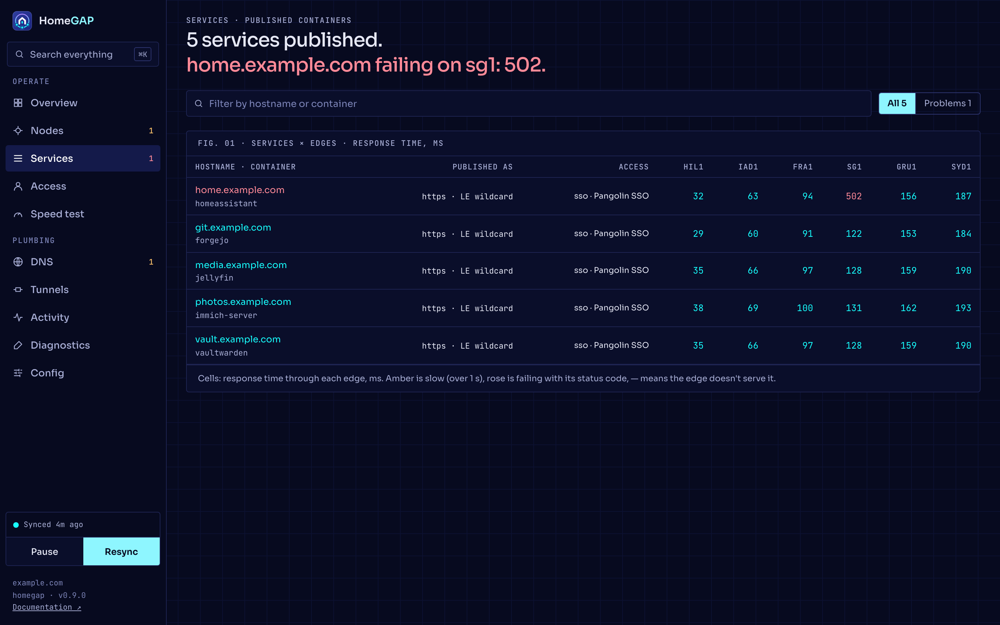
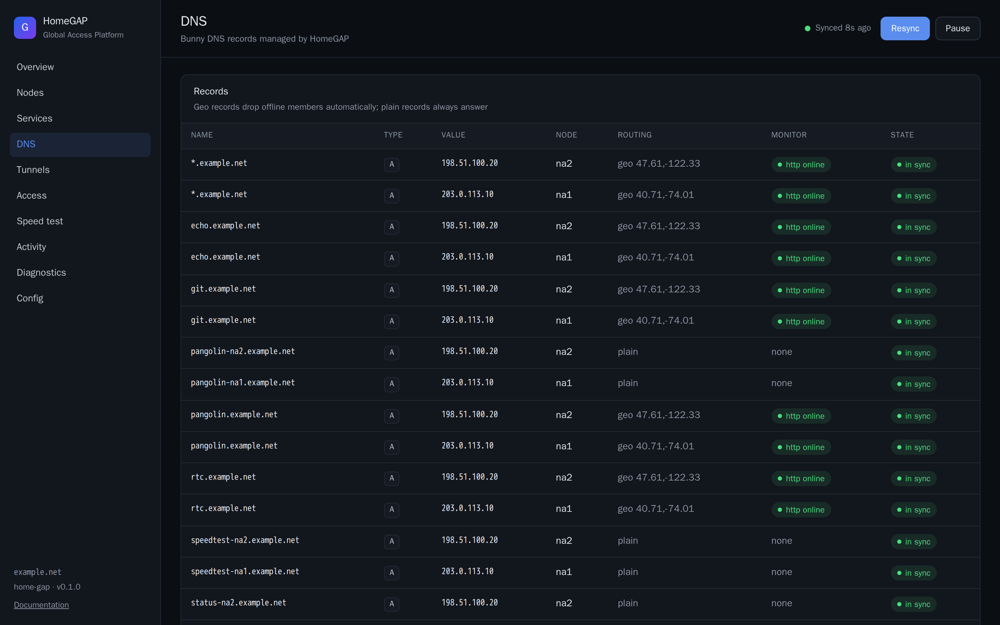
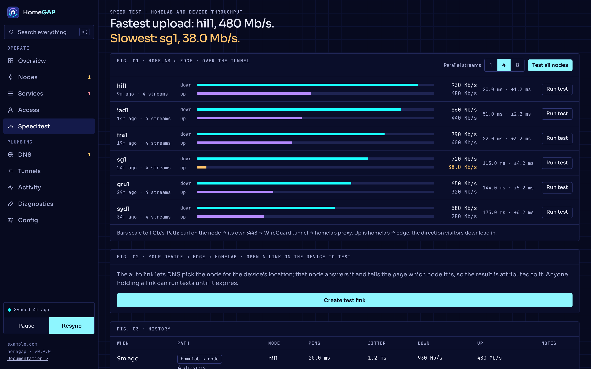
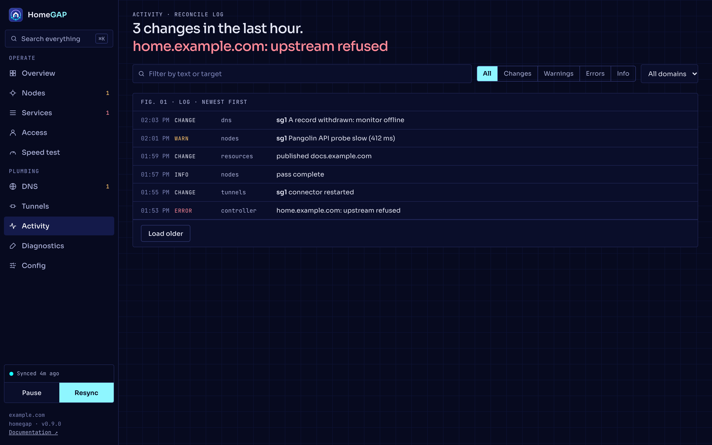
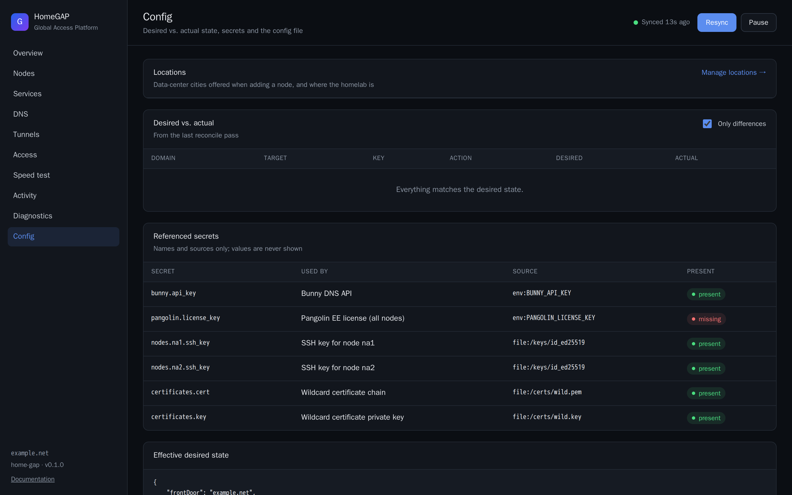

# The dashboard

The orchestrator serves a dashboard on `dashboard.bind`. This page tells you how to reach it safely and what each page shows.

!!! danger "Warning"
    A person with the dashboard token can control every node. Keep the dashboard private: serve it to VPN devices only, or reach it through an SSH tunnel. Make it public only if you accept that the token is then the only protection.

## Serve the dashboard through your Traefik

HomeGAP can give the dashboard a name at the Traefik of your homelab, for example `orc.example.net`. Your Traefik then serves it over HTTPS with its own certificate. You set the name in the config file. The compose file needs no labels.

```yaml
dashboard:
  bind: 0.0.0.0:8088
  hostname: orc
  access: private
```

| Key | Default | What it does |
| --- | --- | --- |
| `dashboard.hostname` | None. | The first label of the name, `<hostname>.<domain>`. Without it, Traefik gets no route for the dashboard. |
| `dashboard.access` | `private` | `private` serves the name to VPN devices only. `public` serves it to everybody. |

The route comes through the HTTP provider that you added to Traefik during the installation. See [Install on the homelab](../getting-started/install.md). The name of the route is `homegap-dashboard`. `dashboard.bind` must be `0.0.0.0:8088`, so that Traefik can reach the dashboard.

### Private access

With `access: private`, only a device on the VPN reaches the name. This mode uses the private path of the front door, so the front door must have the label `homegap.private_network`. See [Client addresses and private-only services](../services/client-addresses.md).

HomeGAP then does two things:

- It makes the name a private name of the front door. VPN devices resolve it to the address of the front door on the private network.
- It adds an allowlist to the route. The allowlist admits only the range of the private network. A request that comes through a node from the internet gets a 403.

A computer on your home network also gets a 403, because it does not come from the private network. Connect that computer to the VPN, or use the address of `dashboard.bind`.

If the front door has no `homegap.private_network`, the dashboard gets no route. The **Services** page then shows the label error "dashboard.access is private, but the front door has no homegap.private_network".

### Public access

With `access: public`, the name answers on the internet, as each other name of the front door does.

!!! danger "Warning"
    A public dashboard has only the token between the internet and your nodes. A person who gets the token can change the config, remove nodes and open a shell on a node. Use a long token that nothing else uses, and set `dashboard.terminal: false` if you do not need the terminal.

HomeGAP limits wrong tokens. An address that sends more than 20 wrong tokens in one minute gets no access for the remainder of that minute.

## Sign in with a service such as Authelia

If the Traefik of your homelab has a forward-auth middleware, for example of Authelia, HomeGAP can use it for the dashboard. A user who signs in there needs no dashboard token. The dashboard must have a name at your Traefik (`dashboard.hostname`).

This sign-in is for the dashboard only. The sign-in of the Pangolin apps is a different part. See [Sign-in](../vpn/sign-in.md).

```yaml
dashboard:
  bind: 0.0.0.0:8088
  hostname: orc
  access: private
  sso:
    middleware: authelia@docker
    groups: [admins]
    read_only_groups: [family]
```

| Key | Default | What it does |
| --- | --- | --- |
| `dashboard.sso.middleware` | None. | The middleware as Traefik names it, with its provider, for example `authelia@docker` or `authelia@file`. |
| `dashboard.sso.groups` | Empty. | The groups with full access. |
| `dashboard.sso.read_only_groups` | Empty. | The groups that can only look. A request from such a user that changes something gets a 403. |
| `dashboard.sso.user_header` | `Remote-User` | The header with the name of the user. |
| `dashboard.sso.groups_header` | `Remote-Groups` | The header with the groups of the user, with commas between them. |

The middleware must add the two headers to the request. In Traefik, these are the `authResponseHeaders` of the forward-auth middleware.

The groups give the role of a user:

- A user in a group of `groups` has full access.
- A user in a group of `read_only_groups` can only look.
- With no `groups` in the config, each other user has full access.
- With `groups` in the config, a user in none of the lists gets no access. The dashboard then asks for the token.

### How it works

HomeGAP adds two middlewares to the route `homegap-dashboard`, after the allowlist of private access. The first one removes the sign-in headers from the request of the client, so a client cannot write them. The second one is your middleware. Traefik asks the sign-in service for each request. The orchestrator accepts the headers only from the front door container, and only for the name of the dashboard.

!!! danger "Warning"
    Do not make a route of your own to the dashboard. On such a route, a client can write the sign-in headers and get full access.

When the session at the sign-in service ends, the dashboard shows the token dialog. Load the page again to sign in.

### When the sign-in service does not work

The sign-in is only on the route of your Traefik. The stack publishes the address of `dashboard.bind` on the loopback address of the homelab, and that address never uses the sign-in. If the sign-in service or Traefik fails, open that address through an SSH tunnel and use the dashboard token. See [Install on the homelab](../getting-started/install.md).

Three cases are useful to know:

- The sign-in service is down. The name of the dashboard gives an error. Use the SSH tunnel.
- You publish the sign-in service through HomeGAP and you pause its service. Sessions that exist continue, because Traefik asks the sign-in service on the Docker network.
- The dashboard has private access. The browser of a VPN device must also reach the name of the sign-in service, or the sign-in page does not open.

The token always gives full access. Each script and each API client continues to use it.

## The token and the live data

A bearer token protects the `/api` routes. Two routes have their own check. The terminal WebSocket uses a one-time ticket, which a request with the token gets. The Traefik of the homelab can read `/api/traefik/homelab` from the front door container without the token.

Set the token with `dashboard.auth_token_env` or `dashboard.auth_token_file`. If the config names no token, or the token is not available, HomeGAP creates one. It keeps that token in the file `dashboard-token` in its data directory, with mode 0600. To read the token, run this command:

```bash
docker compose exec orchestrator cat /data/dashboard-token
```

The dashboard asks for the token in a sign-in dialog and keeps it in the browser. To remove the token from the browser, click **Sign out** at the bottom of the menu. Do this on a computer that other people use.

The dashboard updates live through one server-sent event stream (`/api/events`). After the first snapshot, the stream sends only the parts that change. When the browser tab is hidden for 30 seconds, the dashboard closes the stream. It opens the stream again when you return to the tab.

The orchestrator writes to the stream at least every 25 seconds. If the dashboard gets nothing for 60 seconds, it opens a new stream. The orchestrator keeps 32 streams open at most. A dashboard above that number gets an error until a different one closes.

If the dashboard cannot reach the orchestrator for more than 5 seconds, the dialog **Connection lost** opens. It shows the error and the time to the next try, and it has **Reconnect now**. It closes by itself when the orchestrator answers again. Until then, the page shows the last data from the orchestrator.

## The layout

The menu has two groups. **Operate** has Overview, Nodes, Services, Access and Speed test. **Plumbing** has DNS, Activity, Diagnostics and Config. A number next to a page is the count of items that need attention there. On a tablet the menu is a rail of icons. On a phone it is one row of pages under the header.

The box at the bottom of the menu shows the last pass, and two controls:

- **Resync** queues a pass now.
- **Pause all** stops all changes everywhere. The dashboard asks you to confirm first. HomeGAP then only observes, and every page shows a banner with **Resume**.

During a pause, the box has **Resume all** and **Run one pass**. **Run one pass** applies the changes that wait, and HomeGAP stays paused. An action that changes something during a pause asks you first: **Apply just this** or **Resume everything**.

Each page starts with a headline that states the answer, for example "5 of 6 nodes serve.". A node with a warning still serves, and the headline gives the count of such nodes. Under the headline, a status line shows the most important message. When there are more, **+N more** opens the other messages.

Select a node, a service or another item to open it in the **Inspector**. On a desktop the Inspector is a drawer on the right that does not block the page. On a tablet it is a drawer over the page, and on a phone it is a sheet at the bottom. The Inspector holds the actions for the item. When an item has more than three actions, one is a button and the others are in **More**.

Press ⌘K, Ctrl+K or `/` to search everything. The search finds nodes, services, DNS records, pages, actions such as **Resync now**, log entries and config keys. Type `>` to see only the actions. The search shows the names of config keys and secrets, never their values.

Actions that are risky ask first. An action that you cannot undo, such as **Decommission**, also asks you to type the name. After you remove a node, a message with **Undo** shows for 30 seconds. **Undo** adds the node again with its config.

## The pages

### Overview

The Overview page shows the whole system:

- The gauges: **Nodes healthy**, **Mesh links**, **Services healthy** and **DNS healthy**.
- **Needs attention**: what is wrong now, with the failures first. Select an item to inspect it.
- **Network**: **Traffic path** or **Map**. The traffic path shows the homelab, then one row for each node with its mesh link and its names. The page remembers your choice. See [Maps and locations](maps.md).
- **Nodes, last hour**: one card for each node, with the chart **Requests served**.
- **Services by node**: the response time of each service through each node, in milliseconds.
- **System and recent changes**.

<!-- SCREENSHOT: docs/img/dashboard/overview.png | The Overview page with the gauges, Needs attention and the traffic path -->

### Nodes

The table shows the health of each node, its requests over the last hour, its mesh link and its certificate. The health is `healthy`, `warning`, `failing` or `unknown`. Under the health, the table names the step of a job that runs, for example "writing and starting the stack (2 of 3)". Without a job, it names the check that fails, or it shows the count of differences from the config. **All** and **Problems** filter the table. During an update, a strip above the table shows the part of each node in the rollout.

Select a node to open it in the Inspector. The Inspector has these sections:

- **Checks**, with the checks that fail at the top. See [Node checks](#node-checks).
- The charts: **Requests served**, **Egress to visitors**, **Mesh link in, homelab to node** and **Mesh link out, node to homelab**.
- **Differences from config**, when HomeGAP found drift.
- **System**: the address, the management name, the provider, the system facts and the software version.
- **Runs**: the last 10 runs of provisioning and updates.

The actions on a node are **Re-provision**, **Pause** or **Resume**, **Diagnostics**, **Speed test**, **Terminal**, **Change location** and **Remove**. **Change location** moves the node to a known city or a point on the map. Geo DNS and the maps use the new place from the next pass. After a removal, the action is **Decommission**. After a failed update, the node also has **Retry update** and **Skip update**. See [Manage nodes](nodes.md) and [Node updates and rollback](node-updates.md).

**+ Add node** opens the wizard over the page. When a run fails, **Retry** runs each step again. If something blocked the new SSH connections of the orchestrator, the button shows a time, for example "Retry in 2:59". See [Add a node](../getting-started/add-node.md).

The **Mesh** panel is below the table. For each pair of members, it shows the time of the last WireGuard handshake. A link in use makes a handshake approximately every 2 minutes. See [Mesh](../reference/mesh.md).

<!-- SCREENSHOT: docs/img/dashboard/nodes.png | The Nodes page with the table, the Mesh panel and a node in the Inspector -->

### Services

The page shows each service, with its response time through each node. Amber is slow (over 1 s). Rose is failing, with the status code. A dash means that the node does not serve it.

The health of a service through a node has two parts. The first part is the mesh link of the node. The second part is one HTTPS request through the Traefik of the node, on each pass. HomeGAP sends the request only for public HTTP services, and the request accepts each certificate. No answer in 3 seconds or a 5xx status is a failure.

Filter by hostname or container. Select a service to see how each node serves it, how HomeGAP publishes it and its source labels. Each service has **Pause service** or **Resume service**, and **Logs**, which opens the **Diagnostics** page. An `http` or `https` service also has **Open**.



### DNS

The page shows the records that HomeGAP manages, grouped into record sets. A healthy record set shows as one line. A record set with a problem also shows each member, with its monitor and its state. Filter by name or value. A plain record is in sync only when each nameserver of the zone serves it. The geo steering strip shows which nodes answer now and which are withdrawn, and for how long.



The CAA record sets belong to certificate management. They are read-only, and they link to the **Certificates** tab.

With [extra domains](../services/extra-domains.md), the page also has the **Domains** table. It shows each domain with its DNS zone, its front door and its state.

### Zone records

The **Zone records** tab of the DNS page shows every record of one DNS zone. A record that HomeGAP manages has a lock and shows what it is for. You cannot change a locked record.

Each other record is yours. Click **Add record** to add one, or click a record to edit or delete it. A typical use is a TXT record that a service needs to check your domain. See [DNS routing and health checks](../configuration/dns.md).

### Certificates

A tab of the **DNS** page. It shows the certificate that the nodes share, which node has it, what a visitor gets on each name through each node, and the orders. See [Certificates](../configuration/certificates.md).

### Access

The page shows who can sign in to the apps, and their devices. **+ Add user** and **+ Add machine** are in the head of the page. The **App address** panel has the address for the Pangolin apps, with **Copy** and **Show QR**. Select a person to change their roles, then click **Save**. A person also has **New password**, **Block** or **Unblock**, and **Remove**. A device has **Block** or **Unblock**, and **Delete**.

Without `sign_in.url` in the config, the page shows "Access isn't available right now.". See [Users, machines and devices](../vpn/access.md).

### Speed test

The page measures the latency and the throughput through the real traffic path. **Test all nodes** tests each node in turn on the orchestrator, so the run continues when you close the page. See [Speed tests](speed-tests.md).



### Activity

The page shows the reconcile log, with the newest entry first. Passes that change nothing show as one row with their count. Filter by level, domain or text. Each entry belongs to a numbered pass. Select an entry to see its details, and click **Show pass #N** to see only that pass. **Load older** gets older entries. The orchestrator keeps the last 10,000 entries in its data directory, so the log continues after a restart.



### Diagnostics

The page shows container logs and a read-only snapshot of each node. See [Diagnostics and troubleshooting](troubleshooting.md).

<!-- SCREENSHOT: docs/img/dashboard/diagnostics.png | The Diagnostics page with the logs of the Traefik container of a node -->

### Config

The page shows:

- **Differences**: the differences between the desired state and the actual state.
- **Secrets**: each secret that the config names, as `present` or `missing`. The page never shows the values.
- **Desired state** and **Config file**. Each opens when you select it, and each has **Copy**.

**Locations** in the head of the page opens the Locations page over it. See [Maps and locations](maps.md).



## Terminal

The dashboard can open a shell on a node. The **Terminal** action is in the menu of a node on the **Nodes** page and in the Inspector of the node. The terminal opens in a panel at the bottom of the dashboard, and the panel stays open when you go to a different page.

The shell runs through the SSH connection that the orchestrator already has to the node. The browser gets no key and no password. You are the management user of the node.

- Each session has a tab. You can have 2 sessions for one node and 6 sessions in total.
- A session continues when you close or reload the page. When you open the dashboard again, the tab is there.
- If you open the same session in a second window, that window takes the session.
- **Commands** types a common command for you, for example the list of containers or the log of Traefik.
- A session ends when the shell exits, or when you close its tab. HomeGAP also ends a session that had no browser for 15 minutes, and each session after 8 hours.

The activity log shows when a terminal opens and closes, with the node. It does not record what you type or what the shell prints.

!!! danger "Warning"
    A terminal gives a shell on the node to each person who has the dashboard token. To disable the terminal, set `dashboard.terminal: false`.

## Node checks

The Inspector of a node shows these checks:

| Check | Name on the dashboard | What it shows |
| --- | --- | --- |
| `ssh` | SSH | If the orchestrator can reach the node over SSH. |
| `docker` | Docker | If Docker is on the node, with its version. |
| `traefik` | Traefik | The state of the container: `running`, with its Docker health in parentheses. A container that does not run is a failure. |
| `homegap-maintenance` | Maintenance page | The state of the container of the maintenance page. |
| `homegap-agent` | HomeGAP agent | The state of the container of the agent. |
| `tls-mgmt` | Management certificate | The certificate that the node serves for its management name, with the days that remain. No certificate is a failure. The certificate that HomeGAP renews is a warning when its renewal is late. A different certificate is a warning with fewer than 14 days. |
| `tls-root` | Root name TLS | The certificate that the node serves for the root name. |
| `mesh` | Mesh link | If the homelab and the node had a WireGuard handshake in the last 200 seconds. |
| `mode` | | In dry run, it shows that HomeGAP does no remote access. |

## Banners

The dashboard shows a banner in these cases:

- HomeGAP runs in dry-run mode.
- Changes are paused. The banner has **Resume**.
- A node update fails and holds the rollout. The banner has **Retry** and **Skip** for the node. See [Node updates and rollback](node-updates.md).
- The config has two or more nodes, and none of them answers over SSH. The banner tells you that the homelab cannot reach a node. The nodes continue to serve. After the homelab reaches a node again, a banner tells you how long the loss was. That banner stays for one hour.
- The orchestrator answers requests but refuses the event stream. The banner starts with "No live updates".

## Documentation

The **Documentation** link at the bottom of the menu opens these docs at `/docs/`, for the version that runs.
