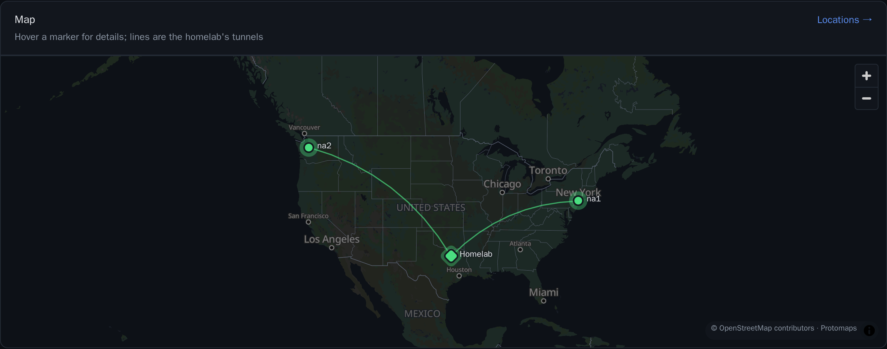
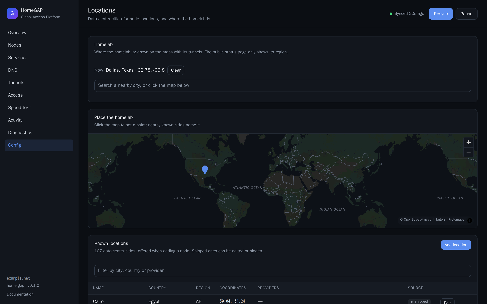

# Maps and locations

The dashboard and the public status page have maps of your nodes and your homelab. This page tells you what the maps show and how to set locations.

## Where the maps are

These pages have a world map that you can drag and zoom:

- The **Overview**, **Speed test** and **Locations** pages.
- The add-node wizard.
- The public status page.

The maps get nothing from a third party. The orchestrator serves all parts:

- The map library (MapLibre GL).
- The styles (Protomaps).
- The fonts and the icons.
- The map data from OpenStreetMap, as one PMTiles file of 45 MB, to zoom level 6. This is enough for cities and regions.

The release image includes the tiles. Without them, the maps still show the markers, on a plain background.

## The Overview map

The Overview map shows every node and the homelab as markers that pulse in their health color. A marker pulses faster when it is not healthy. Lines go from the homelab to each node, in the color of its tunnel.

When you move the pointer over a node, the map shows details of the node. These are its health, its tunnel, its round trip to the homelab, its provider and its failed checks.

When you zoom out, markers that cover each other move apart into a column, with a short line to their real position. When you zoom in, they go back to their exact locations. The known locations of the catalog never move.

## The other maps

On the **Speed test** map, each line has the latest result between the homelab and the node. Click a node to run its test.

In the add-node wizard, search the known data-center cities, for example "dallas", "london" or "hetzner". The search fills in the place name, the region code and the coordinates. Or click the map: the nearest known city within 50 km gives the point its name.

## The Locations page

The **Locations** page is under **Config**. It has two parts.

The homelab location tells the maps where the homelab is. Set it on this page, or set `homelab.location` in the config. The API call is `PUT /api/homelab/location`. The public status page shows only the region of the homelab.

The catalog lists the known locations. Approximately 100 data-center cities come with HomeGAP, with the providers in each city. You can add your own locations, and edit or hide the locations that come with HomeGAP. HomeGAP keeps your changes in `<data_dir>/locations.yml`.

## Custom tiles

To build tiles with more detail, run `tools/build-map.sh tiles` from the repository, with `MAP_MAXZOOM` set to a higher zoom level. The script builds the tiles from a Protomaps build. Then set `map.tiles` to the path of the bigger file.

## Attribution

Map data © OpenStreetMap contributors (ODbL), through Protomaps.
