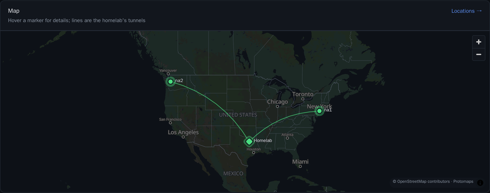
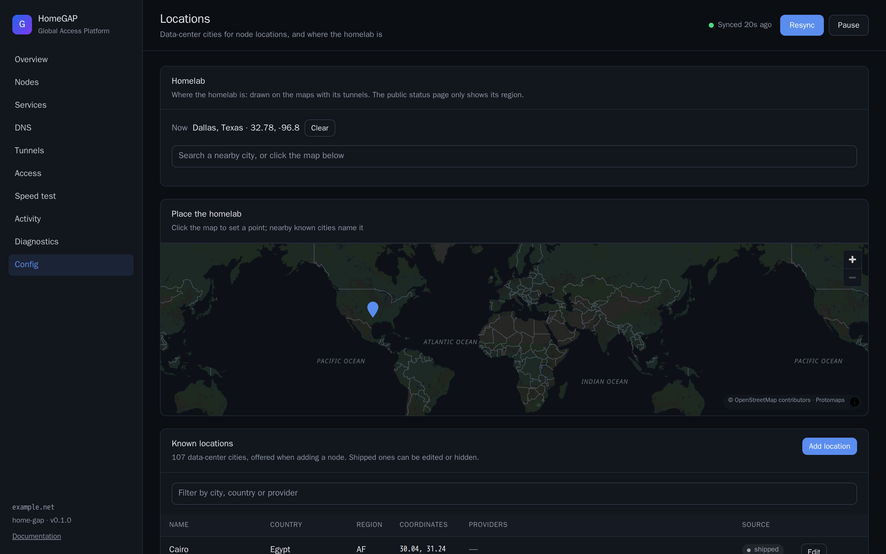

# Maps and locations

The dashboard and the public status page have maps of your nodes and your homelab. This page tells you what the maps show and how to set locations.

## Where the maps are

These pages have a world map that you can drag and zoom:

- The **Overview**, **Speed test** and **Locations** pages.
- The add-node wizard and the **Change location** dialog of a node.
- The public status page.

The maps get nothing from a third party. The orchestrator serves all parts:

- The map library (MapLibre GL).
- The styles (Protomaps).
- The fonts and the icons.
- The map data from OpenStreetMap, as one PMTiles file of approximately 45 MB, to zoom level 6. This is sufficient for cities and regions.

The release image includes the tiles.

## The Overview map

On the **Overview** page, select **Map** in the **Network** panel. The map shows every node and the homelab as markers in their health color. Lines go from the homelab to each node, in the color of its mesh link. The homelab marker and the lines show only after you set the location of the homelab. A node with a region but no location is at the center of its region, marked "(approximate)". A node with neither has no marker.

When you move the pointer over a node, the map shows details of the node. These are its health, its mesh link, its provider, its failed checks and the time of its last provisioning. The details of the homelab show how many mesh links are up.

## The other maps

On the **Speed test** map, each line has the latest result between the homelab and the node. Click a node to run its test.

In the add-node wizard, search the known data-center cities, for example "dallas", "london" or "hetzner". The search gives the place name, the region code and the coordinates. Or click the map: the nearest known city within 50 km gives the point its name.

The **Change location** action of a node uses the same search. Geo DNS and the maps use the new place from the next pass. The API call is `PUT /api/nodes/{id}/location`.

## The Locations page

To open the **Locations** page, click **Locations** in the head of the **Config** page. It has two parts.

The **Homelab** part tells the maps where the homelab is. Search a city or click the map, then click **Save homelab location**. You can also set `homelab.location` in the config. The API call is `PUT /api/homelab/location`. The public status page shows only the region of the homelab.

The **Known locations** part is the catalog. Approximately 100 data-center cities come with HomeGAP, with the providers in each city. You can add your own locations, and edit or remove the locations that come with HomeGAP. The **Source** column shows `shipped`, `edited` or `added`. HomeGAP keeps your changes in `<data_dir>/locations.yml`.

## Custom tiles

To build tiles with more detail, run `tools/build-map.sh tiles` from the repository, with `MAP_MAXZOOM` set to a higher zoom level. The script builds the tiles from a Protomaps build. Then set `map.tiles` to the path of the bigger file. The default path is `/usr/share/homegap/map/world.pmtiles`.

## Attribution

Map data © OpenStreetMap contributors (ODbL), through Protomaps.
