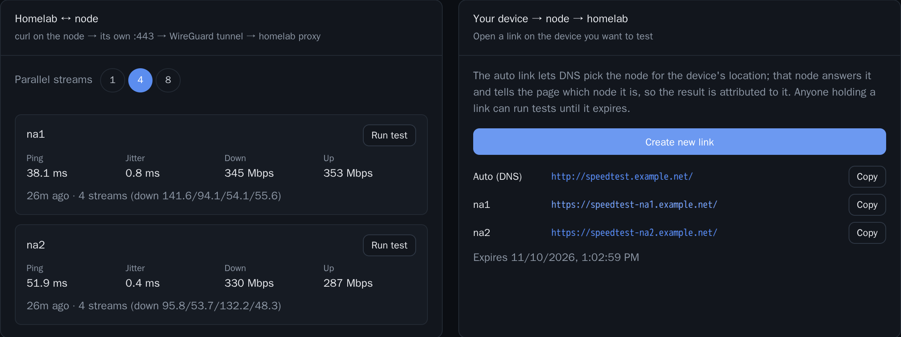

# Speed tests

The speed tests measure the latency and the throughput through the real traffic path. This page tells you how to enable them and what each test measures.

## Enable the speed tests

With `speedtest.enabled: true`, the orchestrator serves a speed test origin on `speedtest.bind`. The speed tests need a front door.

| Key | Default | What it does |
| --- | --- | --- |
| `speedtest.enabled` | `false` | Enables the speed tests. |
| `speedtest.hostname` | `speedtest` | The first label of the names of the speed test. |
| `speedtest.bind` | `0.0.0.0:8089` | The listener of the speed test origin. The status page uses it too. |
| `speedtest.link_ttl` | `2h` | The lifetime of a test link. |
| `speedtest.phase_seconds` | `8` | The length of the download phase and of the upload phase, from 2 to 30. |
| `speedtest.link_budget_gb` | `20` | The data that one test link can send and receive, in GiB. |
| `speedtest.vpn_access` | `false` | Lets a VPN device open the page with no link. |
| `speedtest.streams` | `4` | The parallel streams of a test between the homelab and a node, from 1 to 16. |

The speed test and the status page share one listener, which starts only with the orchestrator. If neither was on at the start, the first activation needs a restart of the orchestrator. A change of `speedtest.bind` also needs a restart.

### Routing

Each node has its own speed test name, `speedtest-<node>.<domain>`. The node sends that name through the front door and the mesh to the homelab. A node answers the shared name `speedtest.<domain>` itself, and sends its requests on to the homelab as `speedtest-<node>.<domain>`.

On the homelab, your Traefik must send these names to the orchestrator on the port of `speedtest.bind` (8089). HomeGAP gives Traefik that route. You add no labels.

The route comes through the HTTP provider that you added to Traefik during the installation. See [Install on the homelab](../getting-started/install.md). When `speedtest.enabled` is `true`, the provider has the route `homegap-pages` with these names:

- `speedtest.<domain>`.
- `speedtest-<node>.<domain>` for each node.

When you add or remove a node, HomeGAP changes the route. When you set `speedtest.enabled` to `false`, HomeGAP removes the names.

The route has no entry point, so it is on each entry point of your Traefik. It has TLS on, and your Traefik gives the certificate from its own TLS settings.

If a name gives a 404, see [The speed test or the status page gives a 404](#the-speed-test-or-the-status-page-gives-a-404).

## The two tests

The **Speed test** page has two tests. Each test measures ping, jitter, download and upload.

### Homelab to node

The orchestrator runs `curl` on the node over SSH. `curl` connects to port 443 of the node, with the speed test name of the node. Thus the traffic takes the production path: the Traefik of the node, the mesh, the Traefik of the homelab and the speed test origin.

The test uses `speedtest.streams` parallel streams, and the rates are the sum. One stream shows what a single connection gets over the distance. Several streams show the capacity of the mesh link. In the results, "Up" is the direction from the homelab to the node. This is the direction of a download by a viewer.

The result also shows how busy the CPU of the node and of the homelab was in each phase, in percent of all cores. "kernel" is the part in the network stack and WireGuard. "steal" is the time that the host of the server gave to other machines. "busiest core" is the core with the most load.

- If the CPU is near 100%, or the steal is high, that machine is the limit, not the network.
- If the busiest core is near 100% and the total is low, one step uses one core only. More cores do not help.
- If the two machines have free CPU, the limit is the network between them.

The test program on the node is a part of the load of the node.

To run the test, click **Run test** for a node, or click a node on the map. **Test all nodes** runs the test on each node in turn, and **Stop** ends the run after the current node.

During a test, a gauge shows it live: the round trip of each ping, then the download rate, then the upload rate. The speed test origin measures these as the traffic arrives. The final figures come from the node when the test ends.

### Your device

This test uses a short-lived link that you open on a device. The link is valid for `speedtest.link_ttl`. A person with the link can run tests until it expires.

1. In the **Your device** panel, click **Create test link**.
2. Click **Copy**, or scan the QR code with the device.
3. Open the link on the device.

The panel has one link for the shared name, **Auto (DNS)**, and one link for each node. `speedtest.<domain>` goes to the node that DNS selects for the device. That node answers the name itself and sends each request on to the homelab under its own name. The address bar keeps `speedtest.<domain>`. Thus the page shows the node, and each result belongs to a node. On HTTP, the node redirects to HTTPS on the same name.

On the page, **Start test** measures the path through the node of the device. **Test all nodes** tests each node in turn through its own name, `speedtest-<node>.<domain>`, from the same page.

The token is in the fragment of the URL. The browser never sends the fragment to a server, so no log contains the token.

A test link has these limits, so that a person with the link cannot use your bandwidth without end:

- 8 streams at the same time for one link, and 32 streams for all links together.
- `speedtest.link_budget_gb` (default 20) GiB of download and upload in total for one link. After that, the link sends and accepts no more data.
- 20 saved results for one link.

The page uses 4 streams. A test between the homelab and a node has no such limit.

### A VPN device with no link

With `speedtest.vpn_access: true`, a VPN device opens `https://speedtest.<domain>/` with no link from the dashboard. The front door must have a private path (`homegap.private_network`). See [Client addresses and private-only services](../services/client-addresses.md).

HomeGAP then makes `speedtest.<domain>` a private name of the front door. A VPN device resolves that name to the private network and gets the page from the homelab, not from a node. The page asks the homelab for a link, and the homelab gives one only to a request from the private network. A visitor who is not on the VPN still needs a link from the dashboard.

On this page, **Start test** measures the path through the VPN to the homelab. **Test all nodes** and the list of nodes measure the path through each node, on its public name.

The link of a VPN device has the same lifetime and the same limits as a link from the dashboard. Each VPN device that can use the private path of the front door can run tests. Enable this key only if you trust those devices with your bandwidth.



## Results

HomeGAP keeps the last 300 results in `<data_dir>/speedtests.json`. The **History** panel shows them. The **Path** column is `homelab ↔ node`, `device` or `VPN device`. The node of a `VPN device` result is `homelab` if the test went through the VPN to the homelab.

## API

| Route | What it does |
| --- | --- |
| `GET /api/speedtest` | Returns the settings and the recent results. |
| `POST /api/speedtest/nodes/{id}` | Runs a test between the homelab and a node. The call returns when the test ends. |
| `GET /api/speedtest/live` | Returns the test between the homelab and a node that runs now, or 204 when none runs. |
| `POST /api/speedtest/runs` | Starts a test of each node in turn. |
| `DELETE /api/speedtest/runs` | Stops that run after the current node. |
| `POST /api/speedtest/link` | Creates a test link for a device. |

## The speed test or the status page gives a 404

Your Traefik does not have the route `homegap-pages`. Do these checks:

1. Make sure that the static configuration of Traefik has the HTTP provider with the address `http://orchestrator:8088/api/traefik/homelab`.
2. Make sure that `dashboard.bind` is `0.0.0.0:8088`, so that Traefik can reach the orchestrator on their shared network.
3. Open the Traefik dashboard and find the router `homegap-pages@http`. Its service must show the orchestrator as up.
4. Read the address directly, with the dashboard token:

    ```bash
    curl -H "Authorization: Bearer $HOMEGAP_DASHBOARD_TOKEN" http://orchestrator:8088/api/traefik/homelab
    ```

    The answer must have the router `homegap-pages` with the names of the speed test and the status page.

The service of the route uses the host name from the address of the provider and the port of `speedtest.bind`. Thus Traefik must reach the orchestrator by that host name on the two ports.
