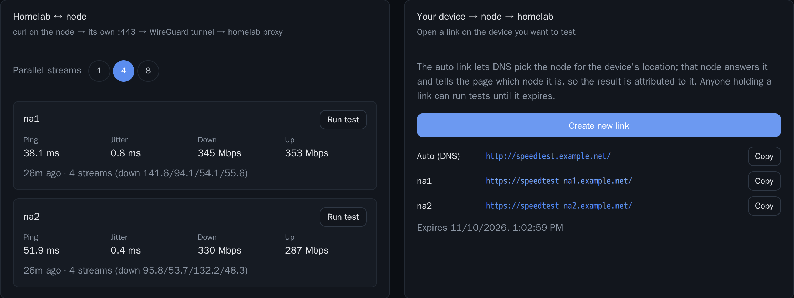

# Speed tests

The speed tests measure the latency and the throughput through the real traffic path. This page tells you how to enable them and what each test measures.

## Enable the speed tests

With `speedtest.enabled: true`, the orchestrator serves a speed test origin on `speedtest.bind`. The speed tests need a front door.

| Key | Default |
| --- | --- |
| `speedtest.enabled` | `false` |
| `speedtest.hostname` | `speedtest` |
| `speedtest.bind` | `0.0.0.0:8089` |
| `speedtest.link_ttl` | `2h` |
| `speedtest.phase_seconds` | `8` |
| `speedtest.link_budget_gb` | `20` |
| `speedtest.streams` | `4` |

A change of `speedtest.enabled` or `speedtest.bind` needs a restart of the orchestrator.

The front door already forwards `speedtest-<node>.<domain>` from the nodes. A node answers the shared name `speedtest.<domain>` itself, and sends its requests on to the homelab as `speedtest-<node>.<domain>`. Route these names to the orchestrator on port 8089 from the homelab Traefik. Put these labels on the `homegap-mesh` service, because it owns the networks of the orchestrator:

```yaml
labels:
  traefik.enable: "true"
  traefik.docker.network: traefik
  traefik.http.routers.homegap-speedtest.rule: "Host(`speedtest.example.net`) || HostRegexp(`^speedtest-[a-z0-9-]+\\.example\\.net$`)"
  traefik.http.routers.homegap-speedtest.entrypoints: websecure
  traefik.http.routers.homegap-speedtest.tls: "true"
  traefik.http.services.homegap-speedtest.loadbalancer.server.port: "8089"
```

The orchestrator is on more than one Docker network. `traefik.docker.network` tells Traefik which network to use. Without it, Traefik can choose a network that it is not on, and each request ends with a 504 after 30 seconds. Use the full name of your Traefik network, as `docker network ls` shows it.

If you also enable the status page, use one rule for both. See [Status page](status-page.md#routing).

## The two tests

The **Speed test** page has two tests. Each test measures ping, jitter, download and upload.

### Homelab ↔ node

The orchestrator runs `curl` on the node over SSH, against port 443 of the node, with the speed test hostname of the node. Thus the traffic takes the production path through the tunnel.

The test uses `speedtest.streams` parallel streams, and the rates are the sum. One stream shows what a single connection gets over the distance. Several streams show the capacity of the tunnel.

The result also shows how busy the CPU of the node and of the homelab was in each phase, in percent of all cores. "Kernel" is the part in the network stack and WireGuard. "Steal" is the time that the host of the server gave to other machines. "Busiest core" is the core with the most load.

- If the CPU is near 100%, or the steal is high, that machine is the limit, not the network.
- If the busiest core is near 100% and the total is low, one step uses one core only. More cores do not help.
- If both machines have free CPU, the limit is the network between them.

The test program on the node is a part of the load of the node.
 You can select the number of streams for each run.

To run the test, click **Run test**, or click a node on the map. **Test all nodes** runs the test on each node in turn.

While a test runs, a gauge shows it live: the round trip of each ping, then the download rate, then the upload rate, with a bar for each sample. The speed test origin measures these as the traffic arrives. The final figures come from the node when the test ends.

### Your device → node → homelab

This test uses a short-lived link that you open on any device. The link is valid for `speedtest.link_ttl`.

1. Click **Create test link**.
2. Click **Copy**.
3. Open the link on the device.

`speedtest.<domain>` goes to the node that DNS selects for the device. That node answers the name itself and sends each request on to the homelab under its own name, `speedtest-<node>.<domain>`. The address bar keeps `speedtest.<domain>`. Thus the page shows the node, and each result belongs to a node. On HTTP, the node redirects to HTTPS on the same name.

The page shows a gauge for each phase as it runs. **Test all nodes** tests each node in turn through its own name, `speedtest-<node>.<domain>`, from the same page. Each result belongs to its node. For this, the speed test origin accepts requests from its own pages under any of its names.

The token is in the fragment of the URL. The browser never sends the fragment to a server, so no log contains the token.

A test link has these limits, so that a person with the link cannot use your bandwidth without end:

- 8 streams at the same time for one link, and 32 streams for all links together.
- `speedtest.link_budget_gb` (default 20) GiB of download and upload in total for one link. After that, the link sends and accepts no more data.
- 20 saved results for one link.

The page uses 4 streams. A test from the homelab to a node has no limit.



## Results

HomeGAP keeps the results in `<data_dir>/speedtests.json`. The **History** panel shows the recent results.

## API

| Route | What it does |
| --- | --- |
| `GET /api/speedtest` | Returns the settings and the recent results. |
| `POST /api/speedtest/nodes/{id}` | Runs a test between the homelab and a node. The call returns when the test ends. |
| `GET /api/speedtest/live` | Returns the running homelab ↔ node test as far as it has got, or 204 when none runs. |
| `POST /api/speedtest/link` | Creates a test link for a device. |
