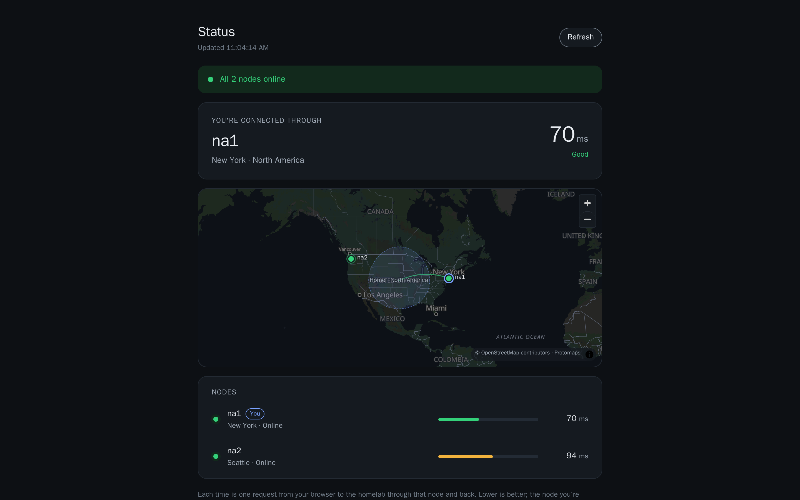

# Status page

The status page is a public page that shows the state of your nodes. This page tells you what it shows, how it works and how to enable it.

## What the page shows

With `status_page.enabled: true`, anybody can open `https://status.<domain>/`. The page shows:

- The node that the visitor came through. This is the node that DNS selects for the location of the visitor. The page also shows the round trip of the visitor to the homelab through this node.
- The state of every node: online, degraded or offline.
- The round trip of the visitor through each other node that is not offline.

| State | Meaning |
| --- | --- |
| Online | The node works. |
| Degraded | The tunnel of the node is up, but a check fails or is down. |
| Offline | The node is paused or in removal, or its tunnel to the homelab is down. A node is also offline while all changes are paused. |

While the page is open, it refreshes every minute.

The page also has a map of the nodes in their status colors. The node of the visitor is highlighted, with the round trip through each node. The map shows the homelab only as a soft area at the center of its region, for example "Home · North America". HomeGAP never sends the location of the homelab to the page.

### What the page tells a visitor

The page and its data are public. For each node, a visitor can read these values:

- The node id and the region.
- The state.
- The location that you set for the node: its name and its coordinates. The map uses them.
- The name `status-<node>.<domain>`. The browser measures the round trip through each node on this name. The name resolves to the public address of the node.

The page does not show IP addresses or the management hosts. But a visitor can find the public address of each node from its `status-<node>` name. The public DNS records of your services give the same addresses.

### Limits on requests

The page needs no token, so HomeGAP limits its requests:

- On the name `status.<domain>`, each node lets one address send 30 requests in a second, with a burst of 150.
- The orchestrator lets one address send 1200 requests in a minute to the page, its data and the map. Above that number, it answers 429.

## How the page works

Each node answers `status.<domain>` itself, with its own certificate. This name never goes through passthrough. On HTTP, the node redirects to HTTPS on the same name.

On HTTPS, the node sends each request on to the homelab under its own name, `status-<node>.<domain>`. That name goes through the front door and the tunnel to the homelab. The address bar keeps `status.<domain>`, and the orchestrator always knows which node the visitor came through. Thus the page, the node list and every ping come from the orchestrator.

For the round trip through each other node, the browser sends one request to `status-<node>.<domain>`. The request goes through that node and its tunnel to the homelab, and back. The browser measures the time with Resource Timing, from the request to the first byte. Thus the time does not include DNS and the setup of the connection.

## Enable the status page

The status page needs a front door. The status page and the speed test share one listener, which starts only with the orchestrator. If neither was on at the start, the first activation needs a restart of the orchestrator.

| Key | Default | Rules |
| --- | --- | --- |
| `status_page.enabled` | `false` | |
| `status_page.hostname` | `status` | A single lowercase label. |
| `status_page.title` | `Status` | 60 characters or fewer. |

### Routing

The status page uses the listener of the speed test, `speedtest.bind`. Thus route `status-<node>.<domain>` to port 8089 too. When both features are enabled, one rule covers both. Put the labels on the `orchestrator` service:

```yaml
labels:
  traefik.enable: "true"
  traefik.docker.network: traefik
  traefik.http.routers.homegap-speedtest.rule: "Host(`speedtest.example.net`) || HostRegexp(`^(speedtest|status)-[a-z0-9-]+\\.example\\.net$`)"
  traefik.http.routers.homegap-speedtest.entrypoints: websecure
  traefik.http.routers.homegap-speedtest.tls: "true"
  traefik.http.services.homegap-speedtest.loadbalancer.server.port: "8089"
```

The orchestrator is on more than one Docker network. `traefik.docker.network` tells Traefik which network to use. Without it, Traefik can choose a network that it is not on, and each request ends with a 504 after 30 seconds. Use the full name of your Traefik network, as `docker network ls` shows it.

To put the homelab on the map, set its location on the **Locations** page. See [Maps and locations](maps.md).


