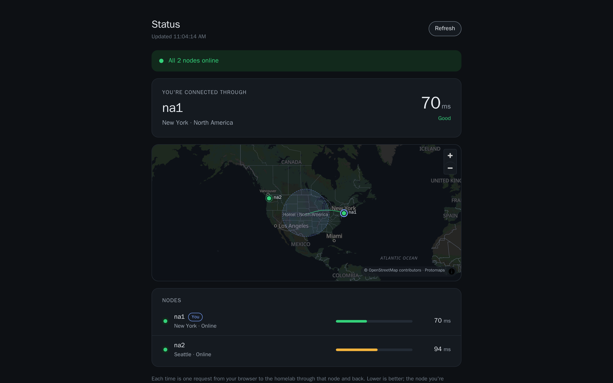

# Status page

The status page is a public page that shows the state of your nodes. This page tells you what it shows, how it works and how to enable it.

## What the page shows

With `status_page.enabled: true`, anybody can open `https://status.<domain>/`. The page shows:

- The node that the visitor came through. This is the node that DNS selects for the location of the visitor. The page also shows the round trip of the visitor to the homelab through this node.
- The state of every node: **Healthy**, **Warning** or **Not serving**.
- The round trip of the visitor through each other node that serves.

| State | Meaning |
| --- | --- |
| Healthy | The node works. In the data of the page, the state is `online`. |
| Warning | The mesh link of the node is up, but a check has a warning or fails. In the data, the state is `degraded`. |
| Not serving | The node is paused or in removal, or its mesh link to the homelab is down. A node also does not serve during a pause of all changes. In the data, the state is `offline`. |

While the page is open, it refreshes every minute. **Refresh** loads the data immediately.

The page also has a map of the nodes in their status colors, with the round trip through each node. The map shows the homelab only as an area at the center of its region, for example "Home · North America". HomeGAP sends the location of the homelab only to a VPN device. See [The page for a VPN device](#the-page-for-a-vpn-device).

### The connection of the visitor

Below the node of the visitor, the page shows one of these lines:

- **Your address**, with the public address that the request came from.
- **Connected to homelab VPN**, for a VPN device. The page shows no address, because the request comes from the private network of the homelab.

The line **Your address** needs `homegap.proxy_protocol: "true"` on the front door. Without that label, the homelab sees an address of Docker for each visitor, and the page shows no line.

### The page for a VPN device

The line **Connected to homelab VPN** needs a private path on the front door (`homegap.private_network`). HomeGAP then makes `status.<domain>` a private name of the front door. A VPN device resolves that name to the private network and gets the page from the homelab, not from a node. See [Client addresses and private-only services](../services/client-addresses.md).

For such a device, the page is different in these ways:

- The page shows **Homelab** in the place of a node. The round trip at the top is the round trip to the homelab through the VPN.
- The map shows the homelab at the location that you set.
- The round trip through each node does not change. The browser sends those requests to the public names of the nodes.

Without a private path on the front door, a VPN device gets the page as each other visitor does.

### What the page tells a visitor

The page and its data are public. For each node, a visitor can read these values:

- The node id and the region.
- The state.
- The location that you set for the node: its name and its coordinates. The map uses them.
- The name `status-<node>.<domain>`. The browser measures the round trip through each node on this name. The name resolves to the public address of the node.

The page does not show the IP addresses of the nodes or the management names. Each visitor sees only the address of that visitor. But a visitor can find the public address of each node from its `status-<node>` name. The public DNS records of your services give the same addresses.

### Limits on requests

The page needs no token, so HomeGAP limits its requests:

- On the name `status.<domain>`, each node lets one address send 30 requests in a second, with a burst of 150.
- The orchestrator lets one address send 1200 requests in a minute to the page, its data and the map. Above that number, it answers 429.

## How the page works

Each node answers `status.<domain>` itself, with its own certificate. This name never goes through passthrough. On HTTP, the node redirects to HTTPS on the same name.

On HTTPS, the node sends each request on to the homelab under its own name, `status-<node>.<domain>`. That name goes through the front door and the mesh to the homelab. The address bar keeps `status.<domain>`, and the orchestrator always knows which node the visitor came through. Thus the page, the node list and every ping come from the orchestrator.

For the round trip through each other node, the browser sends one request to `status-<node>.<domain>`. The request goes through that node and the mesh to the homelab. The browser measures the time with Resource Timing, from the request to the first byte. Thus the time does not include DNS and the setup of the connection.

When the homelab is down, a node shows its "back shortly" page for `status.<domain>`. See [Failure modes](failure-modes.md).

## Enable the status page

The status page needs a front door. The status page and the speed test share one listener, which starts only with the orchestrator. If neither was on at the start, the first activation needs a restart of the orchestrator.

| Key | Default | Rules |
| --- | --- | --- |
| `status_page.enabled` | `false` | |
| `status_page.hostname` | `status` | A single lowercase label. It must be different from `speedtest.hostname`. |
| `status_page.title` | `Status` | 60 characters or fewer. |

### Routing

The status page uses the listener of the speed test, `speedtest.bind`. Your Traefik must send `status-<node>.<domain>` to the orchestrator on that port (8089). HomeGAP gives Traefik that route through the HTTP provider. You add no labels.

When `status_page.enabled` is `true`, the route `homegap-pages` has the name `status-<node>.<domain>` of each node. The shared name `status.<domain>` is not in the route. Each node answers it. With a private path on the front door, the route `homegap-status-private` gives the shared name to VPN devices only. It accepts only the source range of the private network. See [Speed tests](speed-tests.md#routing) for how the route works and how to check it.

To put the homelab on the map, set its location on the **Locations** page. See [Maps and locations](maps.md).

