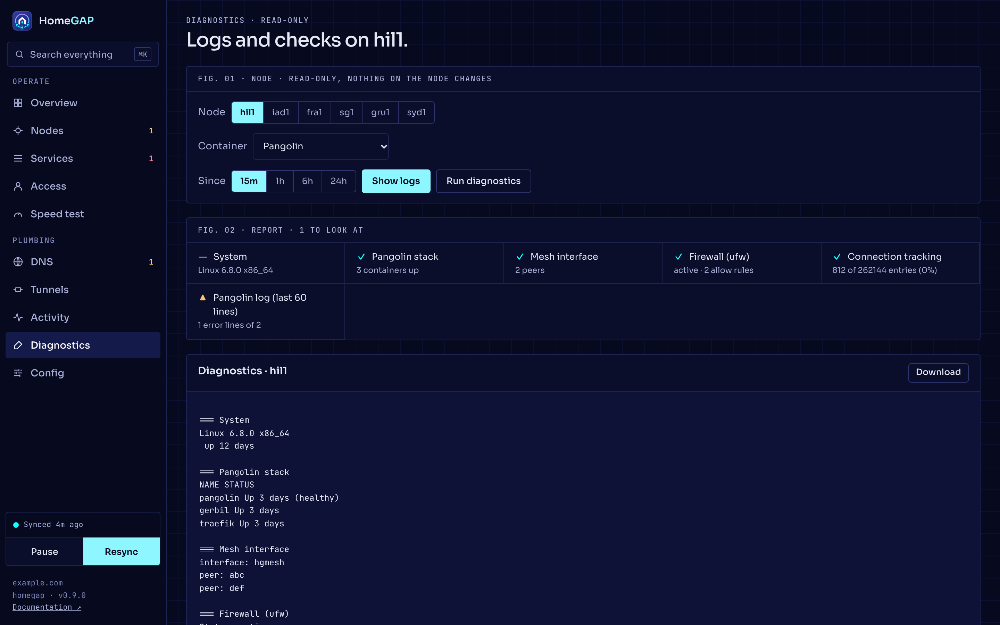

# Diagnostics and troubleshooting

This page tells you where to find logs and diagnostics, and what to check for common problems.

## The Diagnostics page

The **Diagnostics** page shows the logs of the containers in the table below. It also runs a read-only diagnostics bundle. The bundle has:

- The containers, and the backends of the cluster proxy.
- The mesh interface and the probe.
- The addresses, the routes and the Docker networks.
- The listening ports, the firewall, and the NAT and forwarding rules.
- The connection tracking, the kernel messages and the recent logs.

You can download the logs and the bundle as text. Nothing on the node changes, and the output contains no secrets.

1. Select the **Node**.
2. Select the **Container**.
3. Set **Since**.
4. Click **Show logs**, or click **Run diagnostics**.
5. Optional: click **Download**.



### Log services

| Service | Container |
| --- | --- |
| `pangolin`, `gerbil`, `traefik` | The Pangolin stack. |
| `haproxy`, `db`, `valkey`, `sentinel`, `etcd` | The cluster member. |
| `probe` | The mesh probe. |
| `newt` | The exit connector. |

The API calls are `GET /api/nodes/{id}/logs?service=&since=&tail=` and `GET /api/nodes/{id}/diagnostics`. The default of `since` is `30m`. The default of `tail` is 300 lines, and the maximum is 5000.

## Logs on the homelab

Use these commands in the HomeGAP folder:

```bash
docker compose logs -f orchestrator
docker compose logs -f tunnels
```

With `HOMEGAP_DEBUG=1`, the orchestrator prints stack traces for fatal errors.

## Other pages

- The **Activity** page shows the reconcile log, grouped by domain (`GET /api/log?domain=`).
- The **Config** page shows the diff between the desired state and the actual state (`GET /api/diff`).

## Problems and checks

| Problem | What to check |
| --- | --- |
| HomeGAP ignores a label. | The label errors on the **Services** page, for example a hostname that two containers claim. The `discovery` warnings on the **Activity** page, for example an unknown label. See [Services](../services/index.md). |
| A node stays in a provisioning phase. | The **Activity** log and the `ssh` check. HomeGAP tries a failed first provisioning again after 5 minutes. |
| SSH times out, or the server cuts it before login. | A login blocker (fail2ban, sshguard or CrowdSec) can ban the orchestrator. Remove the ban from the console of the provider. Also check `ssh_allow_from` against the public IP address of the orchestrator. |
| A name does not resolve to the nearest node. | The monitor state on the **DNS** page. Failover takes 1 to 5 minutes. One node cannot fail over. |
| A node is not in the wildcard set. | The `ee-license` check. `terminate` on the front door needs an EE license on every node. |
| `http://<node ip>/` returns 502. | The origin is down. |
| `http://<node ip>/` times out. | The tunnel is down. Look at the **Tunnels** page. |
| A browser shows a certificate warning, or a node serves the default certificate. | The **Certificates** tab of the **DNS** page. Read the cause of the last order. See [Certificates](../configuration/certificates.md#expiry-and-failures). |
| The tunnel of a new node stays down. | The node waits for an order with its management name. The **Certificates** tab shows the order. |
| Downloads over long paths are slow. | See [Performance](performance.md). |
| `cluster-proxy` is yellow or red. | See [Cluster database](../cluster/database.md#the-cluster-proxy-check). |
| A handshake is missing in the **Mesh** panel. | The firewall of the provider must open `cluster.mesh.port`/udp. |
| A private name returns 403 on the VPN. | See [Client addresses and private-only services](../services/client-addresses.md#troubleshooting). |
| The orchestrator stops at the start with a `homegap: ...` error. | The config is not valid. Run `homegap validate`. See [Configuration](../configuration/index.md#check-the-file). |

## Undo a first test

To remove a test installation:

1. Set `reconcile.dry_run: true`. This stops all further changes.
2. In the Bunny console, remove the records with the comment `managed-by:homegap`.
3. Restore your previous records.
4. On the homelab, stop the HomeGAP services:
    ```bash
    docker compose down
    ```
5. On each node, stop the stack:
    ```bash
    cd /opt/homegap && sudo docker compose down
    ```
