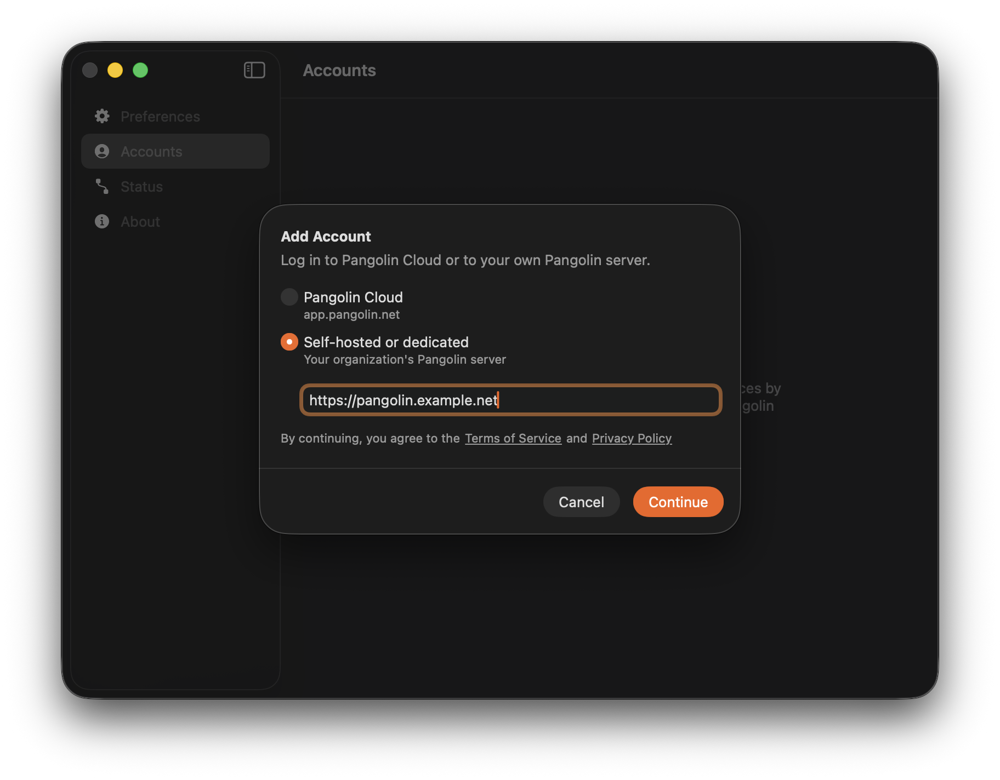
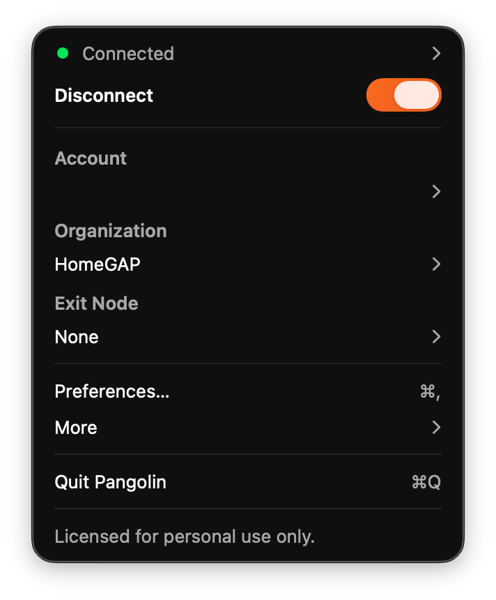

# Connect the Pangolin apps

The Pangolin apps (by Fossorial) for Android, iOS and desktop connect to HomeGAP with no change, and so does the `olm` command line client. This page tells you which address to enter, how a device signs in, what the apps show and what the limits are.

HomeGAP answers the calls that these apps make to a self-hosted server. You install no other server.

## Before you start

- The config has `sign_in.url`, and the sign-in runs. See [Sign-in](sign-in.md).
- The person has a HomeGAP user. See [Users, machines and devices](access.md).
- The device trusts the certificate of the address. The certificate that HomeGAP orders for the nodes from Let's Encrypt meets this.

## The address

The address for the apps is the value of `sign_in.url`, for example `https://vpn.example.net`. The **Access** page of the dashboard shows it in the **App address** panel, with a QR code for a phone.

Each node serves this address. Bunny DNS sends the device to a healthy node, so the address stays the same when a node fails.

## Connect an app

1. Install the Pangolin app for the platform: [Android](https://pangolin.net/downloads/android), [iOS](https://pangolin.net/downloads/ios), [macOS](https://pangolin.net/downloads/mac), [Linux](https://pangolin.net/downloads/linux) or [Windows](https://pangolin.net/downloads/windows).
2. In the app, add an account for a self-hosted server. In the macOS app, this is **Add Account**, then **Self-hosted or dedicated**.
3. Enter the address of the sign-in and click **Continue**.

    

4. The app shows a code and opens the sign-in page of HomeGAP in the browser.
5. Compare the code on the page with the code in the app.
6. Sign in with the provider, or with the email address and the HomeGAP password.

    <!-- SCREENSHOT: docs/img/pangolin/02-homegap-signin.png | The sign-in page of HomeGAP in the browser, with the device, the code and the password form -->

7. The page **Device approved** opens the app again. If it does not, click **Open the app**.
8. Connect the app. The app shows **Connected**.

    

9. On the **Access** page, find the device in **Devices**. Make sure that it shows `online`, with the node that it connects through.

<!-- FACT-CHECK: the download links are from the old page. The source does not show them. -->
<!-- FACT-CHECK: the labels of the Android, iOS, Windows and Linux apps for the self-hosted server and for the address field. The source shows only the macOS dialog in docs/img/pangolin/01-pangolin-setup.png. -->

For each page of the sign-in and its messages, see [What a user sees](sign-in.md#what-a-user-sees).

## Connect a machine with olm

`olm` is the command line client of the Pangolin apps. Use it for a server or another device with no person. A machine has no sign-in in a browser. It connects with an id and a secret.

1. Create the machine on the **Access** page with **+ Add machine**, or run this command:

    ```bash
    docker compose exec orchestrator homegap machine add backup --role Member
    ```

2. Keep the `id` and the `secret`. HomeGAP shows the secret only one time.
3. Give `olm` the address of the sign-in, the id and the secret in these environment variables:

    | Variable | Value |
    | --- | --- |
    | `PANGOLIN_ENDPOINT` | The address of the sign-in, for example `https://vpn.example.net`. |
    | `OLM_ID` | The id of the machine. |
    | `OLM_SECRET` | The secret of the machine. |

4. Start `olm`. In a container, it needs the `NET_ADMIN` capability and the device `/dev/net/tun`:

    ```yaml
    services:
      olm:
        image: docker.io/fosrl/olm:1.10.1
        restart: unless-stopped
        cap_add: [NET_ADMIN]
        devices: ["/dev/net/tun"]
        environment:
          PANGOLIN_ENDPOINT: https://vpn.example.net
          OLM_ID: ${OLM_ID}
          OLM_SECRET: ${OLM_SECRET}
    ```

5. On the **Access** page, make sure that the machine shows `online`.

The machine gets the private services of its roles, as a device of a user does. A machine cannot ask for the list of exits, because it has no session of a user.

`olm` has a local API, which reads its state and selects an exit. The variables `ENABLE_API: "true"` and `HTTP_ADDR: 127.0.0.1:9452` enable it.

<!-- FACT-CHECK: the command line flags of olm and the paths of its local API. The source shows only the environment variables (e2e/compose.yml, service `client`). -->

## What the apps show

- The organization is **HomeGAP**. HomeGAP has one organization, so there is nothing to select.
- The status is **Connected** when the homelab answers the probe of the app inside the tunnel.
- **Exit Node** lists **Exit via <node>** for each node and **Exit via homelab**. The config must enable them, and a role of the user must permit them. See [Exits and tunnel DNS](exit-nodes.md).
- If you block or delete the device, or block or remove its user, the app disconnects. It shows "Your access ended. Sign in again."
- After 30 days, the session ends, and the app asks the user to sign in again.

## What a connected device reaches

- The private services that the roles of its user permit, by their hostnames. Only a connected device resolves and reaches these names. See [Private services](../services/private.md).
- The names that have a private path through the front door of the homelab. See [Client addresses and private-only services](../services/client-addresses.md).
- The internet through an exit, if the user selects one.
- The DNS servers of `vpn.tunnel_dns`.

HomeGAP denies everything else. A device does not reach your home network, another device or the mesh.

## DNS

The app answers the names of your private services itself. HomeGAP gives it the names and their addresses when the device connects.

The app also answers the public names of your services itself. A device connects through one node, and each public name that this node serves gets the address of this node. The traffic of the device for your services then stays on the node that carries its VPN, whatever public DNS answers. A name that only a different node serves, such as `status-na1.example.net`, gets the address of that node. A private name that the user can reach keeps its private address.

For other names, HomeGAP gives the app the DNS servers of `vpn.tunnel_dns.resolvers` (default `8.8.8.8`) and enables DNS through the tunnel. These values override the DNS settings of the app. The lookups then leave from your homelab. A user without a role of `vpn.tunnel_dns.roles` gets no DNS settings from HomeGAP.

<!-- FACT-CHECK: the labels of the DNS settings in each app, and whether a user must change one. PLAN.md says that the values of the server override the settings of the app. The comment in config/config.example.yml says to set the same address as the upstream DNS in each app. -->

## Limits

- A node always relays the traffic. There is no direct path between a device and your home, and no hole punching.
- The tunnel carries IPv4 only.
- The start of a connection takes approximately one second longer than with a direct path. The app first tests the endpoint, gets no answer and then asks for the relay.
- A user needs a HomeGAP user with the same email address, also with an OpenID Connect provider.
- A HomeGAP password has no second factor. A second factor comes from the provider.
- A machine gets no list of exits.
- The harness of HomeGAP runs `olm` 1.10.1. The calls of the apps come from the source of the Android app 0.8.3.

<!-- FACT-CHECK: which versions of the Android, iOS and desktop apps connect to this build. PLAN.md says that the Android app was not run against this build and that only its source was read. -->

## With the homelab down

These points apply with `vpn.exit_nodes.nodes: true`. Without the exits of the nodes, the apps do not connect during the outage.

- A connected device loses the private services. If its roles permit it, it uses the exit of a node.
- A new device signs in at a node with a HomeGAP password and gets the exit of that node only.
- A machine connects with its id and secret and gets the exit of that node only.
- A device with a session of a node signs in again after the homelab returns.

See [With the homelab down](index.md#with-the-homelab-down).

## If an app does not connect

| What you see | What to check |
| --- | --- |
| The app does not accept the address. | Open the address in a browser. It must have a valid certificate, and a node must answer. Check `sign_in.url` and the DNS records of the name. |
| "This code is not known, or it expired." | A code is valid for 10 minutes. Start the sign-in in the app again. |
| "You have no HomeGAP user with this email address. Ask your admin." | Add the user on the **Access** page, with the email address of the provider. |
| The app signs in and does not show **Connected**. | The device must reach UDP port `vpn.port` (default `51830`) of the node. Open it in the firewall of your server provider. |
| An exit of a node does not pass traffic. | The device must reach UDP port `vpn.exit_port` (default `51840`) of the node. |
| A private name does not open. | Check the roles of the user and the `homegap.roles` label of the service. A service with no such label is for `Admin` only. |

For the logs of the sign-in, run `docker compose logs homegap-sign-in` on the homelab. See also [Diagnostics and troubleshooting](../operations/troubleshooting.md).
